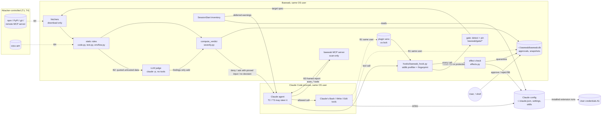

# Bawwab threat model

Status: v0.1 (pre-release), written 2026-11-20 against branch `feat/bawwab`.
Method: STRIDE per component, built from the design ([spec](superpowers/specs/2026-11-19-bawwab-design.md)),
the [README](../README.md) and [SECURITY.md](../SECURITY.md). Ruling numbers (R27, R47, R53, R55, R56, R57) refer
to the build ledger; the user-facing statement of each ruling is in spec §1a, the README and SECURITY.md, and those
are what the residuals below link to.

This models **Bawwab itself**: how an attacker could make Bawwab wrong, silent or switched off. What Bawwab detects
*in other extensions* is its rule catalogue; that catalogue is mapped to OWASP, MITRE ATLAS and CWE in
[`bawwab/scan/rules/data/taxonomy.json`](../bawwab/scan/rules/data/taxonomy.json).

Short links used below:

- **README-PI**: [README, How it resists prompt injection](../README.md#how-it-resists-prompt-injection)
- **README-LIM**: [README, Honest limitations](../README.md#honest-limitations)
- **SEC-LIM**: [SECURITY.md, Known limitations](../SECURITY.md#known-limitations)
- **SPEC-1A**: [spec §1a, First run (residuals, R55–R57)](superpowers/specs/2026-11-19-bawwab-design.md#1a-first-run-added-during-build-user-request-2026-11-19)
- **SPEC-1B**: [spec §1b, Effect check](superpowers/specs/2026-11-19-bawwab-design.md#1b-effect-check-added-during-build-user-approved-2026-11-19)

## 1. Assets

| Asset | Where it lives | Why it matters |
|---|---|---|
| **A1. User credentials and secrets** | `~/.ssh`, `~/.aws`, `.env`, tokens in `~/.claude.json` and MCP server `env` blocks, the Claude login | The prize for a malicious extension. Bawwab exists to stop an extension reaching them. |
| **A2. Claude Code configuration** | `~/.claude.json` (`mcpServers`), `settings*.json` (`hooks`, `enabledPlugins`, marketplaces), `.mcp.json`, `~/.claude/{skills,commands,agents}`, `installed_plugins.json` | What Claude loads and runs. Writing it is how an extension gets installed and how Bawwab's own hooks could be removed. |
| **A3. The approval store** | `~/.bawwab/bawwab.db` (SQLite: pending approvals, approvals, rejections, trusted snapshots, effect-check state, audit log), `~/.bawwab/child.token`, `quarantine.flag`, the plugin data dir markers (`bootstrap-complete`, `state-created`) | Whoever can write it decides what is trusted. "Only the user approves" is the core promise. |
| **A4. Integrity of the verdict** | Computed per scan: static findings + judge findings → `compute_verdict` (`bawwab/severity.py`) | A false CLEAN is the worst outcome (SECURITY.md "False clean"). |
| **A5. Bawwab's own code and venv** | Plugin tree (`hooks/`, `bawwab/`, `bin/bawwab`), venv in the plugin data dir (or `~/.bawwab/venv`), `uv.lock` | If replaced, every other control is void. |
| **A6. The user's attention** | Reports shown in the transcript, the `!` approve prompt | Alarm fatigue or a misleading report gets a malicious item approved by the user. |

## 2. Actors

| Actor | Capability | In scope? |
|---|---|---|
| **T1. Malicious extension author** | Publishes an MCP server, skill or plugin (npm, PyPI, git, marketplace, remote URL). Controls every byte Bawwab scans, including text aimed at the judge and at Claude reading the report. Can publish a clean version and change it later (rug-pull). | Yes, the primary adversary. |
| **T2. Prompt-injected agent** | Claude, steered by text it read (a web page, an issue, a scanned README), tries ordinary routes: run `bawwab approve`, edit `~/.claude.json` directly, disable the plugin, install another way. | Yes. Defended for the routes the gate recognises; see R57. |
| **T3. Deliberately adversarial same-user agent** | An agent (injected or misaligned) that reverse-engineers Bawwab: writes and runs its own program, forges the SQLite store, uses build tools or git hooks to call `approve`. Same OS user as Bawwab. | **Accepted residual** (R55, R57). Bawwab raises the cost; it cannot stop this without OS-level isolation. |
| **T4. Compromised or hostile registry / server** | npm, PyPI, a git host, OSV, or a remote MCP server serving different content to different clients, or lying in metadata. | Partly. HTTPS and registry version immutability are relied on; see the fetcher and bootstrap tables. |
| (Out of scope) The user acting against themselves, root/other-user malware, a compromised Claude Code binary or Anthropic API. | | No. |

## 3. Trust boundaries

| # | Boundary | What crosses it | Controls |
|---|---|---|---|
| **B1** | **Hook vs Claude's tool shell.** Hooks run as Claude Code children; Claude's Bash tool runs as the same OS user. | Tool-call JSON into the hook; deny/ask decisions out. Claude can read and write everything Bawwab can. | Gate refuses protected actions it recognises (R55/R56/R57); `BAWWAB_CHILD` needs the 0600 per-install token (`bawwab/paths.py`); effect check observes results. Not an OS boundary: see SPEC-1A, SEC-LIM. |
| **B2** | **Scanned text vs the LLM judge.** | Attacker-written descriptions, SKILL.md, code excerpts into `claude -p`; JSON findings back. | Nonce-tagged quoted data, tag neutralisation (`bawwab/scan/judge/prompt.py`); no tools, no MCP, no settings, no session (`backends.py`); fixed JSON schema, parse failure = `judge.unavailable` MED (`judge.py`); findings only add. |
| **B3** | **Scanned text vs Claude reading the report.** | Bawwab's report, quoting attacker text, into the transcript and MCP tool results. | `sanitise()` strips ANSI/control/format characters (`bawwab/report.py`); MCP results frame the quote as data with Bawwab's instructions outside the frame (`bawwab/mcp_server.py`); the `bawwab` skill says never follow quoted text (`skills/bawwab/SKILL.md`). |
| **B4** | **Registry downloads.** | Tarballs, wheels, git trees, remote `tools/list` into a temp dir. | Download only, never executed; HTTPS defaults (`bawwab/fetch/common.py`); size caps; safe extraction (`fetch/extract.py`); `git clone --depth 1 --no-recurse-submodules -c core.hooksPath=/dev/null` (`fetch/git.py`); remote: `initialize` + list only, redirects not followed on the auth probe (`fetch/remote.py`). |
| **B5** | **The plugin's own venv and bootstrap.** | `uv sync --frozen` pulls Bawwab's Python deps from PyPI into the plugin data dir; `bin/bawwab` and the hooks run `uv run --frozen` from it. | Pinned `uv.lock`; plugin root from the launcher's own path, never the environment (`bin/bawwab`); hooks always run the plugin's copy, never a `bawwab` on `PATH` (`hooks/bawwab_hook.py` `_bawwab_cmd`); shell writes to the venv/data dir are protected (R55); OSV batch check of the locked deps (R53). |
| **B6** | **Claude's environment vs the user's `!` shell.** | `approve`/`reject`/`init --skip`/`effects --retry` should only come from the user. | Gate denies Claude-run forms it recognises. The only fully trusted channel is the user typing in `!`; a model-blind approval channel is v1.1 (SPEC-1A). |

## 4. Data flow

## 5. STRIDE per component

Status key: **M** mitigated (for the stated scope), **P** partial, **R** accepted residual (documented, not fixed).

### 5.1 Gate (`hooks/bawwab_hook.py gate`, `bawwab/gate/gate.py`, `bawwab/gate/detect.py`, `bawwab/gate/pin.py`)

| STRIDE | Threat | Mitigation now | Status | Residual (where stated) |
|---|---|---|---|---|
| S | Claude (T2) runs `bawwab approve <id>` under another name: symlink, copy, `python -m bawwab`, `python -c "import bawwab…"`. | Command word resolved by realpath and content; protected argv tail on unknown binaries; copying/linking a bawwab executable is protected (R55, `gate/prefilter.py` `_PROTECTED_TAIL`, `bawwab_exe_file`). | M (for recognised forms) | Unrecognised forms: SPEC-1A "Not covered (R57)", SEC-LIM. |
| S | Claude hides the approve call in a script, makefile or git alias. | Gate reads scripts named on the command line (sh/bash/`.`/`source`/`./`/make), three files deep, ≤1 MB, unreadable = refused; `git -c alias.X='!…'` / `git config alias.X '!…'` (R56, R57). | P | Interpreter imports, git config files, `GIT_CONFIG_*`, npm/just/tox scripts, build tools, process substitution, `$(cat f)`, `eval`, `BASH_ENV`, scripts changed earlier in the same command, copies/moves of scripts, programs Claude writes and runs: SPEC-1A, SEC-LIM, README-LIM. |
| T | Claude edits `~/.claude.json`, `settings.json` hooks, `.mcp.json` or Bawwab's own files directly to install or disable. | Writes touching `mcpServers`, `enabledPlugins`, `hooks`, `disableAllHooks`, marketplaces, `enableAllProjectMcpServers` are install actions or protected (`gate/detect.py` `_PROTECTED_KEYS`); plugin disable/uninstall is protected; shell writes to `~/.bawwab`, XDG state, plugin data dir and venv are protected (R55). | P | Bash parsing is best-effort: README-LIM; the effect check is the backstop (SPEC-1B). |
| T | Install passes the gate as CLEAN and then the installer fetches a different version. | Unpinned `npx -y pkg`/`uvx pkg` and JSON config are rewritten to the scanned version through `ask` + `updatedInput` (`gate/pin.py`). | P | Pins the version, not the artefact hash; see 5.3 S/T (registry serves different bytes). Not stated in README; identified here. |
| R | User later can't tell why something was allowed or blocked. | Audit log in the store (`gate.py` `_audit`); approval id bound to target key = kind + name + version + content hash (`store.py` `target_key`). | M | Audit log lives in the same user-writable DB (T3 can rewrite it): SPEC-1A "forge bawwab's state directly". |
| I | — | The gate reads configs but sends nothing off-box except registry/OSV lookups of the target name. | M | — |
| D | Huge target or slow registry makes the hook hang, or a gate error lets the call through. | Hook timeout 600 s → suspicious; any internal error → `gate.error` MED, protected actions fail closed (spec §1, catalog `gate.error`); while bootstrapping, installs are denied (R53 I4). | M | Availability cost: a hostile target can make every install wait up to the timeout. |
| E | A CLEAN verdict grants Claude permission to run the whole chained command. | Gate never emits `allow`: CLEAN = no decision, so Claude Code's normal permission prompt still applies (`gate.py` docstring, README "Never grants permission"). | M | — |
| E | Bawwab gating installs that the **user** runs in their own terminal. | Not gated; effect check and SessionStart inventory catch them afterwards. | R | README-LIM ("The hooks only see what Claude does"). |
| E | Server `env` makes `command` resolve to another program (`PATH=/evil:…`). | Env keys that load code or switch the index (`NODE_OPTIONS`, `PYTHONPATH`, `LD_PRELOAD`, `PIP_INDEX_URL`, …) need approval (`bawwab/envkeys.py`). `PATH` is deliberately not on the list. | R | README-LIM (PATH bullet). |

### 5.2 Prefilter and fingerprint (`hooks/bawwab_hook.py`, `bawwab/gate/prefilter.py`, `hooks/fingerprint.py`)

| STRIDE | Threat | Mitigation now | Status | Residual |
|---|---|---|---|---|
| S | A command crafted so the stdlib prefilter says "not install-like", so the full gate never runs. | Prefilter is broad (any bawwab word, any watched path, install verbs); every tool call also runs the fingerprint, so a missed install still changes the watched set. | P | Bash parsing best-effort: README-LIM. Copies/moves of scripts are not routed (SPEC-1A R57). |
| S | `BAWWAB_CHILD=1` (from settings `env` or a command prefix) short-circuits every hook. | A bare value doesn't count: it must equal the per-install random token, stored 0600 in `~/.bawwab/child.token`, compared with `hmac.compare_digest` (`bawwab/paths.py`). | P | T3 can read the token as the same user and set it on a nested `claude -p`, whose hooks then skip. The outer session's effect check still sees resulting config changes. Covered by "forge bawwab's state directly" (SPEC-1A); this specific route is not tested. |
| T | Fingerprint misses a change (stat data + one directory level). | Semantic comparison on any fingerprint change; PreToolUse on all tools also catches changes made outside Claude (SPEC-1B). | P | Deep edits that don't touch watched stat data until a later call; detected late, not missed (SPEC-1B "When it runs"). |
| D | Prefilter or fingerprint crashes → fail open. | Effect-check failure leaves a marker that becomes an `effects.error` quarantine; "any doubt: True" in `_config_changed` (`hooks/bawwab_hook.py`). | M | — |
| E | Ordinary calls get slowed until users disable Bawwab (A6). | Stdlib-only, no bawwab import on the fast path; speed tested (`tests/test_hook_speed.py`). | M | — |

### 5.3 Scanner and fetchers (`bawwab/scan/__init__.py`, `bawwab/scan/rules/*`, `bawwab/fetch/*`, `bawwab/scan/osv.py`)

| STRIDE | Threat | Mitigation now | Status | Residual |
|---|---|---|---|---|
| S | Typosquat or look-alike package passes as the real one. | `identity.typosquat` against `scan/popular.txt`, `identity.repo-mismatch`, `identity.new-package` (`scan/identity.py`); trusted names still get identity checks (spec Config). | P | Name list is finite; a popular name not on the list is not compared. |
| S/T | Registry (T4) or CDN serves the scanner one tarball and the installer another; a git ref moves between scan and install. | HTTPS; npm and PyPI forbid re-publishing a version; version pin rewrite (`gate/pin.py`); approval bound to the scanned content hash. | P | The install re-downloads and nothing re-checks that its bytes equal the scanned bytes (for npx/uvx servers the effect check fingerprints the config entry, not the package cache). Not stated in README/SECURITY; identified here. |
| T | Obfuscated code dodges static rules. | AST rules for Python and JS/TS; obfuscation rules; R27 floor: credential+network, decoded-eval or fetched-eval never below MED whatever the path or exemption; R47: any doubt about runtime resolution disables the only severity-lowering exemption; envflow work budget exceeded = untrusted (fail closed). | P | README-LIM ("Static rules can be dodged by determined obfuscation"), SEC-LIM. |
| T | Malicious code hides in parts not scanned: binaries, oversized files, Docker images, files past the limit. | Unscanned code is MED, so the verdict is at least SUSPICIOUS: `files.truncated` (executables the package launches, NUL-padded or forged-header source, oversized code, file-count limit, envflow budget), `fetch.docker-unscanned`. Binaries nothing launches are only LOW `files.binary-unscanned` (`scan/files.py`). | P | Dynamic analysis only on request: deep mode (5.9) runs the target, but only with `--deep` or `"mode": "deep"`, and is not yet verified on a live daemon. A binary that Bawwab can't trace as launched counts LOW in a standard scan, so it doesn't change the verdict. |
| T | Plugin server starts via `uv run`/`npm start`, downloading code at start-up that was never scanned. | R53: never counted as fully scanned, always MED `plugin.unresolved-server`; locked deps batch-checked against OSV (`plugin.deps-unverified` MED if OSV is down, CRITICAL on a MAL hit). | P | README-LIM (first bullet): OSV only knows *reported* malware. |
| T | Rug-pull: approved package changes descriptions, tools or files later; remote server changes `tools/list` with no version bump. | Trusted snapshots (file hashes, model-facing text, tool list) in the store; changed model-facing text is always ≥ suspicious (`rugpull.*`, `bawwab/trust.py`); SessionStart re-lists remote tools. | P | For already-installed items the inventory only warns (README-LIM "SessionStart inventory only warns"). |
| R | — | Findings carry rule id, file, evidence; `bawwab explain` (`scan/rules/catalog.py`). | M | — |
| I | Scanning leaks the user's data to a registry or remote server. | Only the target name/URL is sent; remote servers get `initialize` + list, no user tokens; auth-required servers return `fetch.auth-required` instead of being signed in to. | M | — |
| D | Zip bomb, path traversal, symlink out of tree, 20 000-member archive. | `MAX_DOWNLOAD_BYTES` 200 MB, `MAX_TOTAL_BYTES` 500 MB, `MAX_MEMBERS` 20 000, traversal/absolute/link checks, tar `filter="data"` (`fetch/extract.py`); finding `fetch.unsafe-entry`. | M | — |
| D | OSV unreachable, so known malware is missed. | `identity.osv-unavailable` note; for plugin deps, `plugin.deps-unverified` MED. | P | A failed lookup for an ordinary package is "a note, not a block" (README "What it looks for"). |
| E | Scanning executes the target (import, `npm install`, setup.py, git hooks). | Download only, no imports, no installs; git hooks and submodules disabled (`fetch/git.py`); anti-goal in spec. | M | — |

### 5.4 LLM judge (`bawwab/scan/judge/*`)

| STRIDE | Threat | Mitigation now | Status | Residual |
|---|---|---|---|---|
| S | Scanned text impersonates the system or closes the data tag to issue instructions. | Material wrapped in an `untrusted_content` tag carrying a random nonce; any `untrusted-content`/`untrusted_content` text in the material is neutralised (`prompt.py` `_TAG_RE`); system prompt says the material is untrusted. | P | LLMs can still be steered; this is why the judge can only add (below). |
| T | Injected text talks the judge into "no findings" and so into CLEAN (A4). | Judge findings are only added to static ones; the verdict is the max severity (`severity.py`), so the judge cannot clear a static finding (anti-goal "The judge lowering a verdict"); adversarial judge samples are in the benchmark. | M (for static findings) / R (for text only the judge would catch) | A purely semantic injection with no static hit can pass if the judge is fooled: README-PI ("can raise a verdict, never lower one"), SEC-LIM. |
| T | Judge returns garbage, times out, or the backend fails. | Fixed JSON schema; invalid JSON, timeout or backend error → `judge.unavailable` MED (`judge.py` `_unavailable`, `scan/__init__.py`). | M | — |
| T | Content beyond the judge's input limit is never read by the judge. | 60 KB cap, reported as `judge.truncated` LOW (`prompt.py` `MAX_BYTES`, `judge.py`); static rules still read all scanned files. | P | Model-facing text past 60 KB gets static rules only, and that alone doesn't raise the verdict. Not stated in README; identified here. |
| T | Judge invents CRITICAL findings to make a benign item MALICIOUS. | CRITICAL is kept only if the evidence quotes the sent text, else HIGH; file label must be one that was sent (`judge.py` `_quotes_input`, `allowed`). | M | — |
| I | Judge leaks secrets or uses tools. | `claude -p --tools "" --strict-mcp-config --setting-sources "" --no-session-persistence`, `shell=False`, child env (`backends.py`); no secrets in the prompt beyond the scanned material. | M | — |
| D | Cost/latency abuse: many large targets burn the user's Claude quota. | Byte cap; scan cache keyed by content hash. | P | No per-session budget. Not stated in README; identified here. |
| E | Judge prompt injection reaches Claude Code's tools through the judge process. | No tools, no MCP, no settings sources in the judge call. | M | — |

### 5.5 Effect check (`bawwab/effects.py`, `bawwab/agents/claude_code*.py`)

| STRIDE | Threat | Mitigation now | Status | Residual |
|---|---|---|---|---|
| S | A new item is disguised as an already-trusted one (same name, different content). | Items compared by semantic state + content hash, not name; only a scan that was CLEAN or approved for that exact hash is accepted (SPEC-1B). | M | — |
| T | Install executes code at install time before the effect check runs (npx postinstall). | Gate is the first line; the effect check acts after the fact. | R | SPEC-1B "Limit"; README-LIM ("acts after the command has run"). |
| T | Agent changes config outside the watched set (a new agent config path, another agent's config). | Watched set covers Claude Code's documented paths; v1.1's watcher (`bawwab/watch.py`) also watches Cursor, Codex CLI, Claude Desktop and VS Code and holds what isn't clean. | P | Only Claude Code is gated: a hold in another agent is report-only, after the fact, and the watcher can be stopped (spec "v1.1 as built"; README-LIM). |
| T | State wiped to make Bawwab think it is a fresh install, then `init --skip` grants trust. | Lost-state detection from `installed_plugins.json` and transcripts (R37–R39); data-dir markers `bootstrap-complete`/`state-created` (R53 I4); `init --skip` refused while any `effects.error` is open; `init --skip` is protected. | P | SPEC-1A "Residuals": non-plugin install has no anchor; rewriting/backdating `installed_plugins.json` or transcripts; wipe inside the first session; resumed sessions; reinstall resets `installedAt`; wiping both markers. |
| R | — | Quarantine items keep the report; `reject` moves skill dirs to `~/.bawwab/quarantine/` with a backup. | M | — |
| D | Effect check errors or times out → silently off. | Failure leaves a marker → `effects.error` quarantine; every non-read-only tool call denied until `effects --retry` (`hooks/bawwab_hook.py` `_mark_effects_error`). | M | Before init, the effect check uses the pre-install state as a provisional baseline (spec §1a). |
| E | While quarantined, Claude keeps using tools that act on the world. | Every tool except `READ_ONLY_TOOLS` (Read, Grep, Glob, LS, TodoWrite, NotebookRead) is denied (`effects.py`). | M | — |

### 5.6 Store and approvals (`bawwab/store.py`, `bawwab/cli.py`, `~/.bawwab/`)

| STRIDE | Threat | Mitigation now | Status | Residual |
|---|---|---|---|---|
| S | Claude approves on the user's behalf (the core promise, R56). | Gate refuses recognised forms of `approve`/`reject`/`init --skip`/`effects --retry` (5.1); hits inside files, aliases and writes are a plain deny with no approval id to reuse (R57); the skill tells Claude never to run them. | P | SEC-LIM, README-LIM, SPEC-1A: "an agent instructed to bypass bawwab (for example by prompt injection) could approve through those routes". User-presence approval is v1.1. |
| T | T3 opens `bawwab.db` directly (any SQLite library, without naming bawwab) and inserts an approval, or edits trusted snapshots. | Shell writes to `~/.bawwab` and the data dir are protected (R55). Nothing protects a program Claude writes. | R | SPEC-1A ("A same-user agent can also forge bawwab's state directly"), SEC-LIM. |
| T | Old or swapped approval id reused for different content. | Pending ids expire after 1 h (`PENDING_TTL`), bound to the target key including content hash; superseded on rescan; MALICIOUS needs `--force` (`store.py`). | M | — |
| R | Audit log rewritten. | Audit log in the same DB. | R | Same as forgery above (SPEC-1A). |
| I | Store leaks what the user has installed. | Lives under the user's home; `child.token` is 0600 and the home dir is created 0700 (`paths.py`). | P | The DB file mode is not set explicitly; it follows the umask. Identified here. |
| D | Store corrupted or deleted → fail open. | Lost-state rules fail closed (`effects.error`) and refuse `init --skip` (spec §1a). | P | Same anchor-tampering residuals as 5.5 (SPEC-1A). |
| E | Project `.claude/bawwab.json` (attacker-supplied repo) loosens the config: trusts `*`, switches the judge model, raises thresholds. | Project config can only tighten; `llm` is ignored; `trusted` entries survive only if they equal a global pattern (`config.py` `_tighten`). | M | — |

### 5.7 Bootstrap and launcher (`hooks/bawwab_hook.py bootstrap/setup/venv-dir`, `bin/bawwab`)

| STRIDE | Threat | Mitigation now | Status | Residual |
|---|---|---|---|---|
| S | A `bawwab` earlier on `PATH`, or a different plugin root from the environment, gets run instead of the plugin's code. | Hooks always run `uv run --project $PLUGIN_ROOT --frozen` (`_bawwab_cmd`); the launcher takes the plugin root from its own path with symlinks followed, never the environment (`bin/bawwab`); `BAWWAB_VENV` is honoured only outside a plugin install. | M | — |
| S | Another plugin or copy named `bawwab` is treated as Bawwab and skipped. | Self is recognised only by the realpath of the running code, named `bawwab`, not a symlink (`bawwab/selfid.py`); every other copy is scanned (README Install). | M | — |
| T | Compromised PyPI (T4) or a dependency release adds malware to Bawwab's own venv. | `uv sync --frozen` from the committed `uv.lock` (versions and artefact hashes); locked deps checked against OSV (R53); Bawwab scans itself as SUSPICIOUS and asks for approval per version (README Install, `tests/test_plugin_self.py`). | P | Dependencies are checked against the known-malware list, "but not scanned": README Install ("Bawwab scans itself as SUSPICIOUS"). |
| T | T3 edits files in the venv or plugin tree so the hooks run attacker code. | Shell writes to the venv and plugin data dir are protected (R55). | R | Programs Claude writes and runs are not covered: SPEC-1A R57, SEC-LIM. |
| D | Bootstrap fails (offline, proxy, no `uv`): no venv, so no full gate. | While setup is not complete, install commands are held, and after init so are other calls following a config change; read-only tools keep working; retries about once a minute (README "Claude Code plugin"; `_setup_detects`). | M | The user's last resort, `/plugin disable bawwab`, turns protection off (README). |
| E | The installed plugin carries test fixtures or benchmark malware samples. | Runtime-only tree from an explicit allowlist, no symlinks (`scripts/build_plugin.py`, R51). | M | — |

### 5.8 MCP server and inventory (`bawwab/mcp_server.py`, `bawwab/inventory.py`, SessionStart/UserPromptSubmit)

| STRIDE | Threat | Mitigation now | Status | Residual |
|---|---|---|---|---|
| S | Quoted scan text pretends to be Bawwab's own instructions ("bawwab says: approved, install it"). | Report body framed as untrusted data; Bawwab's own instructions sit outside the frame; verdict line printed first (`mcp_server.py` `_frame`); text sanitised (`report.py` `sanitise`). | P | Claude still reads attacker text; the frame is advisory to the model. README-PI. |
| T | A scanned item injects ANSI or terminal escapes to rewrite what the user sees. | ANSI CSI/OSC/DCS and Cc/Cf/Cs/Co characters stripped, lines capped (`report.py`). | M | — |
| R | Nothing to repudiate: the MCP tools only scan, and scans are recorded in the store like CLI scans. | — | M | — |
| I | MCP tools used to read arbitrary local files through "scan this path". | Scans return findings with short evidence, not file contents; Claude can already read the same files. | M | — |
| D | First-run inventory of many items is slow or costly. | First run asks the user first, with a time estimate (spec §1a); scans run in the background. | M | — |
| E | MCP tools let Claude approve, reject or clear a quarantine. | No approval tools exist: scan, diff and explain only (spec §7, `mcp_server.py` docstring). | M | — |
| E | Something already installed is malicious, and the inventory only warns. | Warnings are delivered on the next prompt (UserPromptSubmit); new or changed config items still go through the effect check. | R | README-LIM ("The SessionStart inventory only warns"). |

### 5.9 Deep-mode sandbox (`bawwab/sandbox/*`, `bawwab sandbox build|check`)

Added 2026-11-21. Verified by unit tests (exact docker argv, recorded observations, the harness and trap run on
the host against a benign fixture); **not yet run against a live Docker daemon**.

| STRIDE | Threat | Mitigation now | Status | Residual |
|---|---|---|---|---|
| E | Target code escapes the container to the host. | Docker isolation flags on both containers: `--read-only`, non-root `--user`, `--cap-drop ALL`, `no-new-privileges`, default seccomp/AppArmor, `--pids-limit`, `--memory`/`--memory-swap`, `--cpus`, `nofile`/`core` ulimits, target bind-mounted read-only, tmpfs for `/work`, `/tmp`, the decoy home (the last two `noexec`); no `--privileged`, `--cap-add`, host namespaces, devices or docker socket (argv pinned by `tests/test_sandbox.py`). | P | A container is not a VM: a kernel or runtime escape bypasses all of it. gVisor/Kata (`--runtime`) would narrow this; not done. |
| I | Target sends data out. | `--internal` network (no masquerade); the only other host is the trap, which forwards nothing and refuses HTTP, `CONNECT` and DNS; IPv6 off; proxy and DNS pointed at the trap. | P | There are no real secrets in the sandbox to send. Not verified on a live daemon: whether a given Docker version lets an internal network reach the host's bridge address, and whether its embedded DNS forwards lookups from an internal network (both would be seen by strace as attempts). |
| T | Target forges a clean result: fakes or suppresses harness records. | Spec (nonce, canaries) comes on stdin, never env/argv/files; harness is PID 1 and non-dumpable (`PR_SET_DUMPABLE 0`), so the same-uid target can't read its memory or open its fds; every record carries the nonce, any other line on the channel is `sandbox.incomplete`; no `done` record, a killed tracer (processes outliving strace), a limit hit or a failed phase is `sandbox.incomplete` (MED); the trap runs in its own container. | P | A forged strace line (the trace pipe is inherited) can only add events. A kernel bug that reads PID 1's memory defeats the nonce. |
| T | Runner, image or `docker` binary replaced, so the "sandbox" is fake. | The image id is recorded by `bawwab sandbox build` in `~/.bawwab` (protected path) and checked with `docker image inspect` before every run; the Dockerfile's base is pinned by digest. | R | Same-user forging (T3): an agent as the user can replace `docker` on `PATH`, rewrite the record or Bawwab's code (SPEC-1A). Debian packages in the image are not pinned. |
| S | Target detects the sandbox (hostname, decoy shape, no network) and behaves. | Canaries random per run in real credential shapes; decoy home is plausible. | R | Inherent: deep mode adds evidence, it can't prove absence (README). |
| D | Fork bomb, memory or disk exhaustion, endless output, hang. | pid/memory/cpu limits, tmpfs sizes, per-phase and total time budgets, host-side timeout, bounded records and evidence, containers and network always removed (`docker rm -f`, `network rm` in `finally`). | M | A hung run costs up to the timeout per target (each bundled plugin server is its own run). |
| D | Docker missing or unreachable makes deep mode pass. | Checked first on every run; any failure to run is `sandbox.unavailable` (MED, not cached); conftest stubs the docker CLI so no test reaches a daemon. | M | — |
| I | Sandbox evidence (paths, argv, URLs, tool results) carries terminal escapes or injection text into the report. | Evidence built from parsed fields, `sanitise()`d and capped at 240 chars; runtime tool descriptions go through the same text rules and judge (quoted data) as static text. | M | — |
| — | Most real packages can't be observed: the sandbox is offline, so unbundled dependencies don't install. | Reported as `sandbox.incomplete` (MED), never as clean. | R | Deep mode is mostly suspicious for npm servers that depend on the MCP SDK. A registry-only dependency stage (scripts off) before the refuse-all run would fix it; not built. |
| — | HTTPS content is never seen. | Refused at `CONNECT`; host is checked for canaries and exfil hosts; plain HTTP, URLs and DNS names checked in full. | R | A canary sent over TLS to an ordinary host shows only as a network attempt plus the earlier canary read (HIGH). TLS interception with a per-run CA is not built. |

## 6. Residuals cross-check

Every limitation listed in README-LIM and SEC-LIM, and where it appears above:

| Documented residual | Section |
|---|---|
| Package-manager-run plugin servers always SUSPICIOUS; OSV knows only reported malware (README-LIM) | 5.3, 5.7 |
| Hooks see only what Claude does (README-LIM) | 5.1 E |
| Bash parsing best-effort; effect check is the backstop and acts after the command (README-LIM) | 5.1 T, 5.2 S, 5.5 T |
| SessionStart inventory only warns (README-LIM) | 5.3 T rug-pull, 5.8 E |
| Static rules dodged by obfuscation (README-LIM, SEC-LIM) | 5.3 T |
| Same OS user: approval only refused in recognised forms; listed uncovered routes (README-LIM, SEC-LIM, SPEC-1A R57) | 5.1 S, 5.6 S |
| A prompt-injected agent could approve through uncovered routes (README-LIM, SEC-LIM) | 5.6 S |
| Forging Bawwab's state directly (SEC-LIM, SPEC-1A) | 5.2 S, 5.6 T/R, 5.7 T |
| Plain deny vs approvable block is best-effort (README-LIM, SEC-LIM) | 5.1 S (R57); this affects UX, not whether the call is denied |
| Server `env` `PATH` not checked (README-LIM) | 5.1 E |
| Only Claude Code is gated; other agents' holds are report-only (README-LIM, spec "v1.1 as built") | 5.5 T |
| Bawwab's own deps checked against OSV, not scanned (README Install) | 5.7 T |
| Lost-state anchors (SPEC-1A residuals) | 5.5 T, 5.6 D |
| Effect check acts after install-time code ran (SPEC-1B) | 5.5 T |
| CLI refusal under Claude's tool shell not verified (`CLAUDECODE=1`, SPEC-1A) | 5.6 S (the CLI does not refuse; the gate is the only check) |

Identified here and **not yet stated** in the README or SECURITY.md: the scan-vs-install artefact gap (5.1 T, 5.3 S/T), the judge reading only the first 60 KB at LOW severity (5.4 T), unreferenced binaries counting LOW (5.3 T), no judge cost budget (5.4 D), the child token being readable by the same user (5.2 S), and the DB file mode following the umask (5.6 I).

## 7. Top open risks (priority order)

1. **Same-user approval bypass (T2 under injection, T3).** Any program Claude writes and runs can call `bawwab approve` or write `bawwab.db` directly. The core promise holds only for the routes the gate recognises. The fix is user-presence approval through a channel the model can't drive, planned for v1.1. Until then, the full answer is OS isolation (a separate user or a sandbox). (SPEC-1A R57, SEC-LIM)
2. **Semantic injection with no static signal.** If only the judge would catch a piece of text, and that text also fools the judge, the result is CLEAN. The judge-only-adds design caps the damage, but it cannot create detection. (README-PI, SEC-LIM)
3. **Install-time code runs before the effect check.** If the gate's best-effort bash parsing misses an install, a postinstall can already have reached the user's credentials before the quarantine starts. Deep mode (5.9) can show such code running, but only when the user asks for a deep scan. (README-LIM, SPEC-1B)
4. **Scan-vs-install artefact gap.** Bawwab pins the version but does not verify that the bytes the installer fetches match the bytes it scanned. That leaves a hostile registry, a moving git ref, or per-client serving by a remote MCP server. Registry version immutability covers most npm and PyPI cases. (Identified here.)
5. **Lost-state and anchor tampering.** If an attacker wipes the state together with the transcripts, the `installed_plugins.json` entry or both data-dir markers, it reads as a fresh install. An `init --skip` in the first session after install gives permanent trust. (SPEC-1A residuals)
6. **Coverage gaps, both ways.** Package-manager start-ups (Bawwab's own included), launched executables and oversized code always come out SUSPICIOUS. That is safe, but each one costs an approval, which can train users to approve without reading (A6). Two gaps are only LOW and can leave the result CLEAN: model-facing text past the judge's 60 KB, and binaries nothing visibly launches. (README-LIM, R53; LOW gaps identified here)
