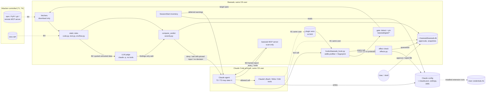

# Bawwab threat model

Status: v0.1 (pre-release), written 2026-11-20 against branch `feat/bawwab`; rows for 0.1.4 (no environment
off switch, scan what installs, quarantine switches the item off, permissions watched) updated 2026-11-22.
Method: STRIDE per component, built from the design ([spec](superpowers/specs/2026-11-19-bawwab-design.md)),
the [README](../README.md) and [SECURITY.md](../SECURITY.md). Ruling numbers (R27, R47, R53, R55, R56, R57) refer
to the build ledger; the user-facing statement of each ruling is in spec §1a, the README and SECURITY.md, and those
are what the residuals below link to.

This models **Bawwab itself**: how an attacker could make Bawwab wrong, silent or switched off. What Bawwab detects
*in other extensions* is its rule catalogue; that catalogue is mapped to OWASP, MITRE ATLAS and CWE in
[`bawwab/scan/rules/data/taxonomy.json`](../bawwab/scan/rules/data/taxonomy.json).

Short links used below:

- **README-PI**: [README, How it resists prompt injection](../README.md#how-it-resists-prompt-injection)
- **README-LIM**: [README, Honest limitations](../README.md#honest-limitations)
- **SEC-LIM**: [SECURITY.md, Known limitations](../SECURITY.md#known-limitations)
- **SPEC-1A**: [spec §1a, First run (residuals, R55–R57)](superpowers/specs/2026-11-19-bawwab-design.md#1a-first-run-added-during-build-user-request-2026-11-19)
- **SPEC-1B**: [spec §1b, Effect check](superpowers/specs/2026-11-19-bawwab-design.md#1b-effect-check-added-during-build-user-approved-2026-11-19)

## 1. Assets

| Asset | Where it lives | Why it matters |
|---|---|---|
| **A1. User credentials and secrets** | `~/.ssh`, `~/.aws`, `.env`, tokens in `~/.claude.json` and MCP server `env` blocks, the Claude login | The prize for a malicious extension. Bawwab exists to stop an extension reaching them. |
| **A2. Claude Code configuration** | `~/.claude.json` (`mcpServers`), `settings*.json` (`hooks`, `enabledPlugins`, marketplaces), `.mcp.json`, `~/.claude/{skills,commands,agents}`, `installed_plugins.json` | What Claude loads and runs. Writing it is how an extension gets installed and how Bawwab's own hooks could be removed. |
| **A3. The approval store** | `~/.bawwab/bawwab.db` (SQLite: pending approvals, approvals, rejections, trusted snapshots, effect-check state, audit log, how each held item was switched off), `quarantine.flag`, `~/.bawwab/disabled/` (held skills), the plugin data dir markers (`bootstrap-complete`, `state-created`) | Whoever can write it decides what is trusted. "Only the user approves" is the core promise. |
| **A4. Integrity of the verdict** | Computed per scan: static findings + judge findings → `compute_verdict` (`bawwab/severity.py`) | A false CLEAN is the worst outcome (SECURITY.md "False clean"). |
| **A5. Bawwab's own code and venv** | Plugin tree (`hooks/`, `bawwab/`, `bin/bawwab`), venv in the plugin data dir (or `~/.bawwab/venv`), `uv.lock` | If replaced, every other control is void. |
| **A6. The user's attention** | Reports shown in the transcript, the `!` approve prompt | Alarm fatigue or a misleading report gets a malicious item approved by the user. |

## 2. Actors

| Actor | Capability | In scope? |
|---|---|---|
| **T1. Malicious extension author** | Publishes an MCP server, skill or plugin (npm, PyPI, git, marketplace, remote URL). Controls every byte Bawwab scans, including text aimed at the judge and at Claude reading the report. Can publish a clean version and change it later (rug-pull). | Yes, the primary adversary. |
| **T2. Prompt-injected agent** | Claude, steered by text it read (a web page, an issue, a scanned README), tries ordinary routes: run `bawwab approve`, edit `~/.claude.json` directly, disable the plugin, install another way. | Yes. Defended for the routes the gate recognises; see R57. |
| **T3. Deliberately adversarial same-user agent** | An agent (injected or misaligned) that reverse-engineers Bawwab: writes and runs its own program, forges the SQLite store, uses build tools or git hooks to call `approve`. Same OS user as Bawwab. | **Accepted residual** (R55, R57). Bawwab raises the cost; it cannot stop this without OS-level isolation. |
| **T4. Compromised or hostile registry / server** | npm, PyPI, a git host, OSV, or a remote MCP server serving different content to different clients, or lying in metadata. | Partly. HTTPS and registry version immutability are relied on; see the fetcher and bootstrap tables. |
| (Out of scope) The user acting against themselves, root/other-user malware, a compromised Claude Code binary or Anthropic API. | | No. |

## 3. Trust boundaries

| # | Boundary | What crosses it | Controls |
|---|---|---|---|
| **B1** | **Hook vs Claude's tool shell.** Hooks run as Claude Code children; Claude's Bash tool runs as the same OS user. | Tool-call JSON into the hook; deny/ask decisions out. Claude can read and write everything Bawwab can. | Gate refuses protected actions it recognises (R55/R56/R57); no environment variable turns the hooks off (0.1.4), and a `BAWWAB_*` key in a settings `env` is a plain deny (`gate/detect.py` `_settings_env`); effect check observes results. Not an OS boundary: see SPEC-1A, SEC-LIM. |
| **B2** | **Scanned text vs the LLM judge.** | Attacker-written descriptions, SKILL.md, code excerpts into `claude -p`; JSON findings back. | Nonce-tagged quoted data, tag neutralisation (`bawwab/scan/judge/prompt.py`); no tools, no MCP, no settings, no session (`backends.py`); fixed JSON schema, parse failure = `judge.unavailable` MED (`judge.py`); findings only add. |
| **B3** | **Scanned text vs Claude reading the report.** | Bawwab's report, quoting attacker text, into the transcript and MCP tool results. | `sanitise()` strips ANSI/control/format characters (`bawwab/report.py`); MCP results frame the quote as data with Bawwab's instructions outside the frame (`bawwab/mcp_server.py`); the `bawwab` skill says never follow quoted text (`skills/bawwab/SKILL.md`). |
| **B4** | **Registry downloads.** | Tarballs, wheels, git trees, remote `tools/list` into a temp dir. | Download only, never executed; HTTPS defaults (`bawwab/fetch/common.py`); size caps; safe extraction (`fetch/extract.py`); `git clone --depth 1 --no-recurse-submodules -c core.hooksPath=/dev/null` (`fetch/git.py`); remote: `initialize` + list only, redirects not followed on the auth probe (`fetch/remote.py`). |
| **B5** | **The plugin's own venv and bootstrap.** | `uv sync --frozen` pulls Bawwab's Python deps from PyPI into the plugin data dir; `bin/bawwab` and the hooks run `uv run --frozen` from it. | Pinned `uv.lock`; plugin root from the launcher's own path, never the environment (`bin/bawwab`); hooks always run the plugin's copy, never a `bawwab` on `PATH` (`hooks/bawwab_hook.py` `_bawwab_cmd`); shell writes to the venv/data dir are protected (R55); OSV batch check of the locked deps (R53). |
| **B6** | **Claude's environment vs the user's `!` shell.** | `approve`/`reject`/`init --skip`/`effects --retry` should only come from the user. | Gate denies Claude-run forms it recognises. The only fully trusted channel is the user typing in `!`; a model-blind approval channel is v1.1 (SPEC-1A). |

## 4. Data flow

## 5. STRIDE per component

Status key: **M** mitigated (for the stated scope), **P** partial, **R** accepted residual (documented, not fixed).

### 5.1 Gate (`hooks/bawwab_hook.py gate`, `bawwab/gate/gate.py`, `bawwab/gate/detect.py`, `bawwab/gate/pin.py`)

| STRIDE | Threat | Mitigation now | Status | Residual (where stated) |
|---|---|---|---|---|
| S | Claude (T2) runs `bawwab approve <id>` under another name: symlink, copy, `python -m bawwab`, `python -c "import bawwab…"`. | Command word resolved by realpath and content; protected argv tail on unknown binaries; copying/linking a bawwab executable is protected (R55, `gate/prefilter.py` `_PROTECTED_TAIL`, `bawwab_exe_file`). | M (for recognised forms) | Unrecognised forms: SPEC-1A "Not covered (R57)", SEC-LIM. |
| S | Claude hides the approve call in a script, makefile or git alias. | Gate reads scripts named on the command line (sh/bash/`.`/`source`/`./`/make), three files deep, ≤1 MB, unreadable = refused; `git -c alias.X='!…'` / `git config alias.X '!…'` (R56, R57). | P | Interpreter imports, git config files, `GIT_CONFIG_*`, npm/just/tox scripts, build tools, process substitution, `$(cat f)`, `eval`, `BASH_ENV`, scripts changed earlier in the same command, copies/moves of scripts, programs Claude writes and runs: SPEC-1A, SEC-LIM, README-LIM. |
| S | Claude hides an approve call in text the gate lets through as "only text": a search pattern (`grep 'bawwab approve' …`) or a commit message (`git commit -m "$(cat <<'EOF' … EOF)"`), which the raw backstop (R25) used to refuse as an approval (P4 false alarms, 0.1.6). | The approval reason is dropped only for (a) one simple command, `grep`/`rg`/`ag`/`ack`/`ugrep` or `git log`/`git grep`, resolving to a system program (or a search-tool name not redefined in the call), optionally piped into fixed readers (`head`, `sort`, …), on one line with no `$`, backquote, backslash, redirect, prefix word or exec-capable option (`rg --pre`, `git grep -O`, `git -c`, `--ext-diff`, …), every `bawwab` inside quotes; and (b) Claude Code's commit idiom with a quoted delimiter and `cat` as the consumer, `git` at a command start, a body with no backquote, `$(`, early delimiter line, unbalanced parenthesis or odd quote count, in a repo with no `commit-msg`/`prepare-commit-msg`/`applypatch-msg` hook, no `core.hooksPath` or `include` in any git config, and no `GIT_DIR`/`GIT_CONFIG*`. In both, the command is analysed again with exactly that text blanked, and the reason must disappear. Every other reason stays (`gate/detect.py` `_literal_text_only`, `tests/test_literal_text.py`). | P | (b) A hook Claude wrote that runs the message is refused as above, but a hook that runs it some other way (a `pre-commit` hook reading `.git/COMMIT_EDITMSG`, a hook in a config the check doesn't read) is not seen; that residual already applies to the plain `git commit -m '…'` form, which always passed. A git hook is a program Claude writes (T3). |
| T | Claude edits `~/.claude.json`, `settings.json` hooks, `.mcp.json` or Bawwab's own files directly to install or disable. | Writes touching `mcpServers`, `enabledPlugins`, `hooks`, `disableAllHooks`, marketplaces, `enableAllProjectMcpServers` are install actions or protected (`gate/detect.py` `_PROTECTED_KEYS`); plugin disable/uninstall is protected; shell writes to `~/.bawwab`, XDG state, plugin data dir and venv are protected (R55). | P | Bash parsing is best-effort: README-LIM; the effect check is the backstop (SPEC-1B). |
| T | Claude writes the same files through a tool other than Bash/Write/Edit/MultiEdit: `NotebookEdit` (`notebook_path`), or an MCP tool (`mcp__<server>__<tool>`, plugin servers included) that writes files. | `NotebookEdit` gets the file-target checks Write/Edit get (`gate/detect.py` `_file_tool`, `gate/prefilter.py` `_FILE_TOOLS`): Bawwab's own state is protected, and since the written notebook is not simulated, any edit of a Claude config file (settings with hooks/`mcpServers`/`enabledPlugins`, `~/.claude.json`, `.mcp.json`) or into a skills/commands/agents/plugins dir is protected (fail closed); the cell's new source, IPython shell escapes stripped (`!cmd`, `%%bash`), goes through the R55/R56 bawwab-command checks. MCP tools: no pre-call detection; the PostToolUse effect check runs right after every `mcp__*` call (5.2). | P | MCP tool effects are opaque: what a call writes can't be known before it runs, so an MCP write into Claude's config is caught by the effect check after the call (quarantined before Claude's next call), not blocked before it. Install-time code such a write starts in the same call has already run (SPEC-1B). `PowerShell` and `Monitor` likewise get only the post-call check. Identified here; not yet stated in README/SECURITY. |
| T | Install passes the gate as CLEAN and then the installer fetches a different version. | Unpinned `npx -y pkg`/`uvx pkg`, `@latest` and any other npm dist-tag (`@next`, `@beta`; 0.1.4) and JSON config are rewritten to the scanned version through `ask` + `updatedInput` (`gate/pin.py`). | P | Pins the version, not the artefact hash; see 5.3 S/T (registry serves different bytes). |
| R | User later can't tell why something was allowed or blocked. | Audit log in the store (`gate.py` `_audit`); approval id bound to target key = kind + name + version + content hash (`store.py` `target_key`). | M | Audit log lives in the same user-writable DB (T3 can rewrite it): SPEC-1A "forge bawwab's state directly". |
| E | One approval covers more than the user decided: after `approve --force` on one malicious MCP server, a second server running the same code was accepted silently (0.1.5 walkthrough, flow 3), because approvals were keyed by content alone. | Since 0.1.6 the approval of a non-clean verdict is bound to the item as well as the content key: the item's ident, and for a Claude Code server `mcp:<name>`, the name the gate reads from `claude mcp add <name>` / `add-json` / a config write (`store.py` `item_ids`, `item_approvals`; `gate/detect.py` `Targets.items`). Each server name an install creates needs its own approval at the gate, and every item the effect check, the inventory or the watcher sees needs its own (`effects._item_ids`). An approval with no item (an unnamed gate target such as a copied skill, `bawwab scan`, or one from before 0.1.6) is claimed by the first item that uses it, and only by that one (`Store.is_approved`). Migration 7 binds approvals already given through the quarantine to their item. Synthetic keys (hooks, settings, toggles, permissions, batches, protected actions) already name one item or action. A clean result stays cached by content. Rejections stay by content: rejecting one copy holds every copy of that code until approved again (the safe direction). `tests/test_approval_binding.py`. | M | Items that shared an approval before the upgrade and were already accepted stay accepted until they change or are rescanned; an older unclaimed approval goes to whichever item uses it first. |
| E | A protected-action approval is reused for a different command. | Every protected action's pending approval is bound to the exact tool input (command text, or file path and content) and the reason (`gate.py` `protected_key`), not to a pattern. Kept on purpose (0.1.6 review): Bawwab can't tell which part of a command made it protected or what else the command does, so an approval of `git commit …` can't mean "this kind of commit"; a broader key would let Claude rerun an approved command with a different tail. The cost is a new approval for each new command, which is why the false-alarm shapes are fixed at detection instead (`_literal_text_only`, `allow-env`). | M | Each approval is one-off, so a dev workflow that keeps hitting a protected action asks again every time. |
| I | — | The gate reads configs but sends nothing off-box except registry/OSV lookups of the target name. | M | — |
| D | Huge target or slow registry makes the hook hang, or a gate error lets the call through. | Hook timeout 600 s → suspicious; any internal error → `gate.error` MED, protected actions fail closed (spec §1, catalog `gate.error`); while bootstrapping, installs are denied (R53 I4). | M | Availability cost: a hostile target can make every install wait up to the timeout. |
| E | A CLEAN verdict grants Claude permission to run the whole chained command. | Gate never emits `allow`: CLEAN = no decision, so Claude Code's normal permission prompt still applies (`gate.py` docstring, README "Never grants permission"). | M | — |
| E | Bawwab gating installs that the **user** runs in their own terminal. | Not gated; effect check and SessionStart inventory catch them afterwards. | R | README-LIM ("The hooks only see what Claude does"). |
| E | Server `env` makes `command` resolve to another program (`PATH=/evil:…`). | Env keys that load code or switch the index (`NODE_OPTIONS`, `PYTHONPATH`, `LD_PRELOAD`, `PIP_INDEX_URL`, …) need approval (`bawwab/envkeys.py`). `PATH` is deliberately not on the list. | R | README-LIM (PATH bullet). |

### 5.2 Prefilter and fingerprint (`hooks/bawwab_hook.py`, `bawwab/gate/prefilter.py`, `hooks/fingerprint.py`)

| STRIDE | Threat | Mitigation now | Status | Residual |
|---|---|---|---|---|
| S | A command crafted so the stdlib prefilter says "not install-like", so the full gate never runs. | Prefilter is broad (any bawwab word, any watched path, install verbs); every tool call also runs the fingerprint, so a missed install still changes the watched set. | P | Bash parsing best-effort: README-LIM. Copies/moves of scripts are not routed (SPEC-1A R57). |
| S | An environment value (from settings `env` or a command prefix) switches the hooks or the judge off: `BAWWAB_CHILD`, `BAWWAB_FAKE_JUDGE`. | 0.1.4: there is no child switch any more. Bawwab's own `claude -p` children (judge, reviewer) run with `--setting-sources ""` (no `enabledPlugins`, so no plugin and no plugin hook loads; checked live on Claude Code 2.1.308) and `--settings '{"disableAllHooks": true}'`, so they never needed one (`scan/judge/backends.py`). `BAWWAB_FAKE_JUDGE` is honoured only when the package runs from bawwab's source checkout (its `tests/` next to it); the plugin tree and wheels ship none. The gate makes a `BAWWAB_*` key in a settings `env` a plain deny and names the env keys any `env` change adds, changes or removes (`gate/detect.py` `_settings_env`); `BAWWAB_CHILD`/`BAWWAB_HOME` assignments in commands stay protected. | M | Bawwab's state dir still follows `BAWWAB_HOME`; a T3 agent that sets it outside the recognised routes lands on lost-state detection (5.5). |
| S | `bawwab allow-env <repo>` (0.1.6, user only) lets a command set `BAWWAB_HOME` for tests; Claude uses that to point a nested Claude Code at a store it forged (copy `bawwab.db` into the repo, insert approvals, run `claude` with that home). | Only the user can add a repo (`allow-env` is a protected subcommand, like `approve`); the list is `~/.bawwab/allow-env.json`, found from `HOME` even when `BAWWAB_HOME` points elsewhere, and writes to it are protected (R55). A command is let through only when its cwd and every `BAWWAB_HOME=<literal path>` (plain, `export` or `env` assignment; no `$`, `~`, glob, heredoc, `$(…)`) lie inside one allowed repo, symlinks resolved, and not the repo itself; it may not name `claude` in any word, `HOME`, `CLAUDE_CONFIG_DIR` or `cd` (`gate/detect.py` `_allowed_test_home`). And whatever starts it, Bawwab's hooks never enforce from a `BAWWAB_HOME` inside an allowed repo: every tool call but the read-only ones is denied (`hooks/bawwab_hook.py` `_test_home`), so a test home can't stand in for the user's state. The home dir, `/`, and dirs holding `~/.claude` or Bawwab's state can't be allowed (`bawwab/allowenv.py`). | P | A program the command runs (a test, a script Claude wrote) can still start other programs with that home; the hooks' refusal covers Claude Code, and anything else is a program Claude writes (T3). |
| T | Fingerprint misses a change (stat data + one directory level). | Semantic comparison on any fingerprint change; PreToolUse on all tools also catches changes made outside Claude (SPEC-1B). The fingerprint also stats the local code MCP server entries run (script, package dir, `uv run` project; paths cached by the config files' stat data, so an idle call parses nothing) and follows symlinks by the same rule as the content hash (5.5). | P | Deep edits that don't touch watched stat data until a later call; detected late, not missed (SPEC-1B "When it runs"). |
| T | A tool other than Bash/Write/Edit/MultiEdit/NotebookEdit changes the watched config, and the change is seen only at the next call's PreToolUse (a one-call window). | The PostToolUse effect check (`hooks/bawwab_hook.py` `_post_tool`) runs for the tools that can write files: Bash, PowerShell, Monitor, Write, Edit, MultiEdit, NotebookEdit, and every MCP tool (`mcp__*`, which covers plugin-provided servers, `mcp__plugin_<plugin>_<server>__*`). It starts with the stat fingerprint, so an unchanged call costs only that; read-only and non-writing built-ins (Read, Grep, Glob, LS, WebFetch, ToolSearch, Agent, ...) never pay for it (`tests/test_tool_coverage.py`). | P | A non-MCP tool not on the list that writes files (a future built-in) is caught at the next PreToolUse, which runs the fingerprint on every tool. A `Monitor` command's later output is likewise caught at the next call. |
| D | Prefilter or fingerprint crashes → fail open. | Effect-check failure leaves a marker that becomes an `effects.error` quarantine; "any doubt: True" in `_config_changed` (`hooks/bawwab_hook.py`). | M | — |
| E | Ordinary calls get slowed until users disable Bawwab (A6). | Stdlib-only, no bawwab import on the fast path; speed tested (`tests/test_hook_speed.py`). | M | — |

### 5.3 Scanner and fetchers (`bawwab/scan/__init__.py`, `bawwab/scan/rules/*`, `bawwab/fetch/*`, `bawwab/scan/osv.py`)

| STRIDE | Threat | Mitigation now | Status | Residual |
|---|---|---|---|---|
| S | Typosquat or look-alike package passes as the real one. | `identity.typosquat` against `scan/popular.txt`, `identity.repo-mismatch`, `identity.new-package` (`scan/identity.py`); trusted names still get identity checks (spec Config). | P | Name list is finite; a popular name not on the list is not compared. |
| S/T | Registry (T4) or CDN serves the scanner one tarball and the installer another; a git ref moves between scan and install; the scanner reads a different artefact than the installer installs. | HTTPS; npm and PyPI forbid re-publishing a version; version pin rewrite incl. dist-tags (`gate/pin.py`); approval bound to the scanned content hash. The scanned bytes are the ones the registry vouches for: npm tarballs against `dist.integrity` (SRI, strongest algorithm; else `shasum`), PyPI files against their sha256 (`fetch/common.py` `download`). PyPI scans the file pip would install here: a pure-Python wheel, else the best-fitting platform wheel (`packaging.tags`), else the sdist (`fetch/pypi.py` `pick_file`, 0.1.4; it used to prefer the sdist). | P | The install re-downloads and nothing re-checks that its bytes equal the scanned bytes (for npx/uvx servers the effect check fingerprints the config entry, not the package cache; local servers are bound to their files, 5.5). The wheel is picked for the Python bawwab runs on: a server run by another interpreter or platform may install another wheel or build the sdist. |
| T | Obfuscated code dodges static rules. | AST rules for Python and JS/TS; obfuscation rules; R27 floor: credential+network, decoded-eval or fetched-eval never below MED whatever the path or exemption; R47: any doubt about runtime resolution disables the only severity-lowering exemption; envflow work budget exceeded = untrusted (fail closed). | P | README-LIM ("Static rules can be dodged by determined obfuscation"), SEC-LIM. |
| T | Malicious code hides in parts not scanned: binaries, oversized files, Docker images, files past the limit. | Unscanned code is MED, so the verdict is at least SUSPICIOUS: `files.truncated` (executables the package launches, NUL-padded or forged-header source, oversized code, file-count limit, envflow budget), `fetch.docker-unscanned`. Binaries nothing launches are only LOW `files.binary-unscanned` (`scan/files.py`). | P | Dynamic analysis only on request: deep mode (5.9) runs the target, but only with `--deep` or `"mode": "deep"`, and is not yet verified on a live daemon. A binary that Bawwab can't trace as launched counts LOW in a standard scan, so it doesn't change the verdict. |
| T | Plugin server starts via `uv run`/`npm start`, downloading code at start-up that was never scanned. | R53: never counted as fully scanned, always MED `plugin.unresolved-server`; locked deps batch-checked against OSV (`plugin.deps-unverified` MED if OSV is down, CRITICAL on a MAL hit). | P | README-LIM (first bullet): OSV only knows *reported* malware. |
| T | Rug-pull: approved package changes descriptions, tools or files later; remote server changes `tools/list` with no version bump. | Trusted snapshots (file hashes, model-facing text, tool list) in the store; changed model-facing text is always ≥ suspicious (`rugpull.*`, `bawwab/trust.py`); SessionStart re-lists remote tools. | P | For already-installed items the inventory only warns (README-LIM "SessionStart inventory only warns"). |
| R | — | Findings carry rule id, file, evidence; `bawwab explain` (`scan/rules/catalog.py`). | M | — |
| I | Scanning leaks the user's data to a registry or remote server. | Only the target name/URL is sent; remote servers get `initialize` + list, no user tokens; auth-required servers return `fetch.auth-required` instead of being signed in to. | M | — |
| D | Zip bomb, path traversal, symlink out of tree, 20 000-member archive. | `MAX_DOWNLOAD_BYTES` 200 MB, `MAX_TOTAL_BYTES` 500 MB, `MAX_MEMBERS` 20 000, traversal/absolute/link checks, tar `filter="data"` (`fetch/extract.py`); finding `fetch.unsafe-entry`. | M | — |
| D | OSV unreachable, so known malware is missed. | `identity.osv-unavailable` note; for plugin deps, `plugin.deps-unverified` MED. | P | A failed lookup for an ordinary package is "a note, not a block" (README "What it looks for"). |
| E | Scanning executes the target (import, `npm install`, setup.py, git hooks). | Download only, no imports, no installs; git hooks and submodules disabled (`fetch/git.py`); anti-goal in spec. | M | — |

### 5.4 LLM judge (`bawwab/scan/judge/*`)

| STRIDE | Threat | Mitigation now | Status | Residual |
|---|---|---|---|---|
| S | Scanned text impersonates the system or closes the data tag to issue instructions. | Material wrapped in an `untrusted_content` tag carrying a random nonce; any `untrusted-content`/`untrusted_content` text in the material is neutralised (`prompt.py` `_TAG_RE`); system prompt says the material is untrusted. | P | LLMs can still be steered; this is why the judge can only add (below). |
| T | Injected text talks the judge into "no findings" and so into CLEAN (A4). | Judge findings are only added to static ones; the verdict is the max severity (`severity.py`), so the judge cannot clear a static finding (anti-goal "The judge lowering a verdict"); adversarial judge samples are in the benchmark. | M (for static findings) / R (for text only the judge would catch) | A purely semantic injection with no static hit can pass if the judge is fooled: README-PI ("can raise a verdict, never lower one"), SEC-LIM. |
| T | Judge returns garbage, times out, or the backend fails. | Fixed JSON schema; invalid JSON, timeout or backend error → `judge.unavailable` MED (`judge.py` `_unavailable`, `scan/__init__.py`). | M | — |
| T | Content beyond the judge's input limit is never read by the judge. | 60 KB cap, reported as `judge.truncated` LOW (`prompt.py` `MAX_BYTES`, `judge.py`); static rules still read all scanned files. | P | Model-facing text past 60 KB gets static rules only, and that alone doesn't raise the verdict. Not stated in README; identified here. |
| T | Judge invents CRITICAL or HIGH findings to make a benign item MALICIOUS or SUSPICIOUS. | CRITICAL and HIGH are kept only if the evidence quotes the sent text (≥ 20 chars verbatim), else LOW, which counts toward no verdict at the default thresholds; file label must be one that was sent (`judge.py` `_quotes_input`, `UNGROUNDED`, `allowed`). | M | An unquoted judge MED still counts as SUSPICIOUS. |
| I | Judge leaks secrets or uses tools. | `claude -p --tools "" --strict-mcp-config --setting-sources "" --settings '{"disableAllHooks": true}' --no-session-persistence`, `shell=False` (`backends.py`); no secrets in the prompt beyond the scanned material. | M | — |
| D | Cost/latency abuse: many large targets burn the user's Claude quota. | Byte cap; scan cache keyed by content hash. | P | No per-session budget. Not stated in README; identified here. |
| E | Judge prompt injection reaches Claude Code's tools through the judge process. | No tools, no MCP, no settings sources in the judge call. | M | — |

### 5.4a Reviewer (`bawwab/scan/review/*`, spec §4a)

| STRIDE | Threat | Mitigation now | Status | Residual |
|---|---|---|---|---|
| T | Scanned text talks the reviewer into "keep" so the user approves a malicious item (A6). | Advice only: the verdict, findings, blocking and approval are unchanged; MALICIOUS caps to dont-install/cant-tell; a `real` assessment rules out keep; every finding must be covered with a quote Bawwab finds verbatim near the cited line; text aimed at "the reviewer" is named as an attack in the prompt; any failed check is cant-tell. Live runs (2026-11-21): two reviewer-aimed fixtures came back "don't install" and named the steering attempt. | P | A convincing misreading of real code can still win `keep` on a SUSPICIOUS item: grounding proves the quote exists, not that the reading is right. Measured by eval/RESULTS.md §7 (reviewer metrics), not yet run in full. |
| T | The reviewer reads outside the target (secrets on disk) through its read requests. | Paths relative, no `..`/`~`/NUL, resolved under the fetched root with `lstat` on every part (no symlinks), `O_NOFOLLOW`, regular files only, 8 reads / 60 KB / 3 calls / 240 s. | M | — |
| I | Advice text carries instructions to the in-session Claude that relays it. | Sanitised; inside the MCP tools' untrusted frame; labelled "advice, not a verdict"; the skill says the user still decides and runs approve/reject. | P | The relaying Claude reads model output derived from hostile code; the same frame and skill rules as reports apply. |
| D | Extra model calls on every non-clean scan. | Clean scans skip it; cached with the report; `review.enabled: false` turns it off. | P | Up to 3 calls (≤ 240 s) per non-clean scan. |

### 5.5 Effect check (`bawwab/effects.py`, `bawwab/agents/claude_code*.py`)

| STRIDE | Threat | Mitigation now | Status | Residual |
|---|---|---|---|---|
| S | A new item is disguised as an already-trusted one (same name, different content). | Items compared by semantic state + content hash, not name; only a scan that was CLEAN or approved for that exact hash is accepted (SPEC-1B). | M | — |
| T | Code changes under an unchanged, already-accepted entry: a local MCP server's script or package (`node /path/server.js`, `python ./srv.py`, `uv --directory <dir> run`, a local binary), another installed copy of a plugin, a file behind a symlink. | A server item's value is its entry plus the content hash of the local code it runs (the script file; the package dir holding it, nearest `package.json`/`pyproject.toml`/`setup.py` up to 4 levels; `uv run`'s `--directory`/`--project`; a command that is a path; node `-r`/`--import` preloads), and the fingerprint stats the same paths, so a change is re-scanned (or re-quarantined, for an unscannable entry) (`claude_code_watch.py` `server_payloads`/`payload_roots`). A plugin item's value hashes every registered `installPath`, and with more than one copy each copy is also its own item scanned at that copy. Symlinks: followed (dirs once each, by device and inode) with their link text hashed, in both the fingerprint and the content hash; the scanner itself never follows links and flags links leaving the tree. Fail closed: a change behind any link is a changed item. | P | Not resolved (the entry's text stays the binding): a bare command found on `PATH`, `python -m <module>`, `$VAR` paths, `uv run` without `--directory`/`--project`. The project tree itself (a project dir, the home dir, `/`, or a parent of one) is never a payload tree: a server that runs the project is bound to its entry and named script file only, and modules a lone script imports from outside its package are not bound. Files over 20 MB are bound by stat data (size, mtime, ctime, inode), not content. npx/uvx registry caches: 5.3. Cursor, Codex and the other watched agents' servers keep the entry text. |
| T | Install executes code at install time before the effect check runs (npx postinstall). | Gate is the first line; the effect check acts after the fact. | R | SPEC-1B "Limit"; README-LIM ("acts after the command has run"). |
| T | Agent changes config outside the watched set (a new agent config path, another agent's config). | Watched set covers Claude Code's documented paths; v1.1's watcher (`bawwab/watch.py`) also watches Cursor, Codex CLI, Claude Desktop and VS Code and holds what isn't clean. | P | Only Claude Code is gated: a hold in another agent is report-only, after the fact, and the watcher can be stopped (spec "v1.1 as built"; README-LIM). |
| T | State wiped to make Bawwab think it is a fresh install, then `init --skip` grants trust. | Lost-state detection from `installed_plugins.json` and transcripts (R37–R39); data-dir markers `bootstrap-complete`/`state-created` (R53 I4); `init --skip` refused while any `effects.error` is open; `init --skip` is protected. | P | SPEC-1A "Residuals": non-plugin install has no anchor; rewriting/backdating `installed_plugins.json` or transcripts; wipe inside the first session; resumed sessions; reinstall resets `installedAt`; wiping both markers. |
| R | — | Quarantine items keep the report and how the item was switched off; `reject` moves skill dirs to `~/.bawwab/quarantine/` with a backup; config edits keep a backup in `~/.bawwab/backups/`. | M | — |
| D | Effect check errors or times out → silently off. | Failure leaves a marker → `effects.error` quarantine; every non-read-only tool call denied until `effects --retry` (`hooks/bawwab_hook.py` `_mark_effects_error`). | M | Before init, the effect check uses the pre-install state as a provisional baseline (spec §1a). |
| E | While quarantined, Claude keeps using tools that act on the world. | Every tool except `READ_ONLY_TOOLS` (Read, Grep, Glob, LS, TodoWrite, NotebookRead, AskUserQuestion) is denied (`effects.py`). | M | — |
| E | A held item still runs while it is held: a server or plugin starts at the next launch, a hook fires on events, a status line or `apiKeyHelper` runs, `env` reaches every child. | 0.1.4: holding an item also switches it off, reversibly (`claude_code.py` `disable_plan`/`apply_disable`/`restore`): a server entry or code-running setting leaves its file, a settings hook leaves its event, a skill/command/agent moves to `~/.bawwab/disabled/`, a plugin is set to `false` in `enabledPlugins` in each settings file in view where it was `true`. The plan is stored before the change (`quarantine.disabled`/`dstate`), every step is idempotent and compared with the plan, a crash is finished by the next check; an item absent because bawwab took it out stays held, one that comes back unchanged is switched off again; approve restores exactly that, so the restored item has the approved hash and nothing is held again (`tests/test_quarantine_disables.py`). Never switched off: bawwab's own plugin id or anything naming the running bawwab. | P | Not switched off: toggles (what they enable is held and switched off itself), marketplaces (nothing runs until a plugin is installed), permissions (5.5 row below; every tool call is denied while held), install-time batches (hooks and settings that ran before bawwab: switching a user's existing setup off on `init --scan` would break it until they decide), the watcher's holds in other agents. A plugin enabled in a project not in view stays enabled there (that session's tool calls are still denied). Install-time code already ran (row above). |
| T | Claude widens its own permissions (`permissions.allow: ["Bash(*)"]`, `defaultMode: bypassPermissions`, a deny rule removed) so later commands run without the user's prompt. | 0.1.4: `permissions` is watched through a projection (`claude_code_watch.py` `permissions_projection`): unscoped or shell/`sudo`-prefix Bash allows, unscoped Write/Edit allows, `defaultMode` `bypassPermissions`/`acceptEdits`, and the deny/ask rules. A widening is an `effects.permissions` hold; a narrow allow doesn't move the semantic digest, and a new deny/ask rule is accepted silently (`tests/test_permissions_watch.py`). Permissions already there when first seen (an install from before 0.1.4) are the baseline. | P | Interpreter prefixes (`Bash(python3:*)`, `Bash(npm:*)`) are treated as narrow to keep ordinary "don't ask again" answers silent, though they can run arbitrary code; `defaultMode: auto` and other permission keys (`additionalDirectories`) are not checked. A project's settings first seen with a broad rule are its baseline. |

### 5.6 Store and approvals (`bawwab/store.py`, `bawwab/cli.py`, `~/.bawwab/`)

| STRIDE | Threat | Mitigation now | Status | Residual |
|---|---|---|---|---|
| S | Claude approves on the user's behalf (the core promise, R56). | Gate refuses recognised forms of `approve`/`reject`/`init --skip`/`effects --retry` (5.1); hits inside files, aliases and writes are a plain deny with no approval id to reuse (R57); the skill tells Claude never to run them. | P | SEC-LIM, README-LIM, SPEC-1A: "an agent instructed to bypass bawwab (for example by prompt injection) could approve through those routes". User-presence approval is v1.1. |
| T | T3 opens `bawwab.db` directly (any SQLite library, without naming bawwab) and inserts an approval, or edits trusted snapshots. | Shell writes to `~/.bawwab` and the data dir are protected (R55). Nothing protects a program Claude writes. | R | SPEC-1A ("A same-user agent can also forge bawwab's state directly"), SEC-LIM. |
| T | Old or swapped approval id reused for different content. | Pending ids expire after 1 h (`PENDING_TTL`), bound to the target key including content hash; superseded on rescan; MALICIOUS needs `--force` (`store.py`). | M | — |
| R | Audit log rewritten. | Audit log in the same DB. | R | Same as forgery above (SPEC-1A). |
| I | Store leaks what the user has installed. | Lives under the user's home; the home dir is created 0700 (`paths.py`); config backups are 0600. | P | The DB file mode is not set explicitly; it follows the umask. Identified here. |
| D | Store corrupted or deleted → fail open. | Lost-state rules fail closed (`effects.error`) and refuse `init --skip` (spec §1a). | P | Same anchor-tampering residuals as 5.5 (SPEC-1A). |
| E | Project `.claude/bawwab.json` (attacker-supplied repo) loosens the config: trusts `*`, switches the judge model, raises thresholds. | Project config can only tighten; `llm` is ignored; `trusted` entries survive only if they equal a global pattern (`config.py` `_tighten`). | M | — |

### 5.7 Bootstrap and launcher (`hooks/bawwab_hook.py bootstrap/setup/venv-dir`, `bin/bawwab`)

| STRIDE | Threat | Mitigation now | Status | Residual |
|---|---|---|---|---|
| S | A `bawwab` earlier on `PATH`, or a different plugin root from the environment, gets run instead of the plugin's code. | Hooks always run `uv run --project $PLUGIN_ROOT --frozen` (`_bawwab_cmd`); the launcher takes the plugin root from its own path with symlinks followed, never the environment (`bin/bawwab`); `BAWWAB_VENV` is honoured only outside a plugin install. | M | — |
| S | Another plugin or copy named `bawwab` is treated as Bawwab and skipped. | Self is the install at the realpath of the running code, or an install holding byte-identical runtime files and nothing else that could run (`selfid.same_code`, 2026-11-20); it must be named `bawwab` and not a symlink (`bawwab/selfid.py`). Any other copy is scanned; the name proves nothing. | M | The running tree itself is trusted as-is, not checked against a signed manifest: whoever can replace Bawwab's own files (same OS user, T3) defines "self". |
| S | A tree that calls itself `bawwab` is copied into an install dir and the user waves it through as "my build" (0.1.6 shows such a copy in one line instead of a scan of Bawwab's own source). | Still an approval, at every level (it replaces the hooks that protect the user). The one-line form is used only when the scan is SUSPICIOUS (never MALICIOUS: that gets the full report and `--force`) and the tree is a plain dir named `bawwab` in plugin.json, with `hooks/bawwab_hook.py`, holding only runtime and inert files (`selfid._code` strict: any other file, a link leaving the tree, an unreadable entry, and it's reported like any plugin). The line names how many runtime files differ from the running code and the first three, and the command that shows the full scan (`gate.py` `_build_block`, `selfid.other_build`, `tests/test_other_build.py`). | P | A modified Bawwab (hooks weakened) passes as "a different build" if the user approves without looking at the files listed; the scan's findings are one command away, not on screen. |
| T | Compromised PyPI (T4) or a dependency release adds malware to Bawwab's own venv. | `uv sync --frozen` from the committed `uv.lock` (versions and artefact hashes); locked deps checked against OSV (R53); Bawwab scans itself as SUSPICIOUS and asks for approval per version (README Install, `tests/test_plugin_self.py`). | P | Dependencies are checked against the known-malware list, "but not scanned": README Install ("Bawwab scans itself as SUSPICIOUS"). |
| T | T3 edits files in the venv or plugin tree so the hooks run attacker code. | Shell writes to the venv and plugin data dir are protected (R55). | R | Programs Claude writes and runs are not covered: SPEC-1A R57, SEC-LIM. |
| T | The printed `approve` command names a file Claude rewrote, so the user's next approve runs Claude's code. Since 0.1.6 a marketplace install prints the stable launcher `<plugins>/data/<id>/bin/bawwab` (as `~/…`), so a command stays valid after an upgrade. | It lives in the plugin data dir, where shell writes are protected (R55); it is printed only while its bytes are exactly the ones Bawwab writes for the running version and it is a regular, user-owned file that only the user can write (`bawwab/clicmd.py` `stable_ok`); otherwise the version's own `bin/bawwab` is printed. Bawwab rewrites it at every session start and after setup (`hooks/bawwab_hook.py` `_refresh_stable_launcher`), never through a symlink. Its path comes from the plugin tree's own path, never the environment. Claude running it is the same protected call as running `bin/bawwab` (its name is `bawwab`, R55). | R | Same as the version's own launcher: a program Claude writes (T3) can rewrite either file after the check and before the user types the command. No new route: the file is as exposed as `bin/bawwab` and `bawwab.db`. |
| S | **Planted shim (opt-in `bawwab setup --link`).** Once the user links, messages print bare `bawwab approve <id>`. Claude puts its own `bawwab` first on the user's `PATH` (or replaces the shim, or defines a `bawwab` alias or function in an rc file), so the user's next `! bawwab approve X` runs Claude's code: approve every pending id, `--force` a malicious one, or turn a `reject` into an `approve`. | Off by default; only the user can switch it on (`setup --link` is a protected subcommand, like `approve`). Bare `bawwab` is printed only when, at that moment, `shutil.which("bawwab")` on the hook's `PATH` is a regular, user-owned, not group/other-writable file in `~/.local/bin` or `~/bin` whose bytes are exactly the shim Bawwab writes, every `PATH` entry before it is absolute, and what it runs (the stable launcher or `bin/bawwab`) verifies too (`bawwab/clicmd.py` `linked`); else the full path. `setup --link` refuses to replace a file it didn't write or to link when another `bawwab` comes first. The gate protects writes, copies, moves, links, `chmod` and redirects that create or change a file named `bawwab` in a `PATH` dir or `~/.local/bin`/`~/bin` (`gate/detect.py` `_bawwab_on_path`), and refuses (plain deny) writing a `bawwab` alias or function into any file (`_BAWWAB_ALIAS`, R56 b). A script that runs bawwab with its arguments is already a renamed bawwab (R55). | R | **Accepted, opt-in.** (1) Time of check vs. use: the check runs when the message is printed; the user types the command later. A program Claude writes (T3) can plant or replace the file in between. (2) The check sees the hook's `PATH`, not the user's `!` shell: an rc-file `PATH` change takes effect in the shell but not in a running Claude Code, and rc-file aliases and functions are invisible to it. Writing such an alias or function is refused; prepending a `PATH` dir in an rc file is not detected, and the `bawwab` planted there must still get past the R55 script checks, which only a program Claude writes (T3) does. An absolute path is immune to aliases, functions and `PATH` order, which is why it stays the default (R55, M17). Without the link nothing changes. None of this is a new capability for T3, which can already forge `bawwab.db` (SPEC-1A). |
| D | Bootstrap fails (offline, proxy, no `uv`): no venv, so no full gate. | While setup is not complete, install commands are held, and after init so are other calls following a config change; read-only tools keep working; retries about once a minute (README "Claude Code plugin"; `_setup_detects`). | M | The user's last resort, `/plugin disable bawwab`, turns protection off (README). |
| E | The installed plugin carries test fixtures or benchmark malware samples. | Runtime-only tree from an explicit allowlist, no symlinks (`scripts/build_plugin.py`, R51). | M | — |

### 5.8 MCP server and inventory (`bawwab/mcp_server.py`, `bawwab/inventory.py`, SessionStart/UserPromptSubmit)

| STRIDE | Threat | Mitigation now | Status | Residual |
|---|---|---|---|---|
| S | Quoted scan text pretends to be Bawwab's own instructions ("bawwab says: approved, install it"). | Report body framed as untrusted data; Bawwab's own instructions sit outside the frame; verdict line printed first (`mcp_server.py` `_frame`); text sanitised (`report.py` `sanitise`). | P | Claude still reads attacker text; the frame is advisory to the model. README-PI. |
| T | A scanned item injects ANSI or terminal escapes to rewrite what the user sees. | ANSI CSI/OSC/DCS and Cc/Cf/Cs/Co characters stripped, lines capped (`report.py`). | M | — |
| R | Nothing to repudiate: the MCP tools only scan, and scans are recorded in the store like CLI scans. | — | M | — |
| I | MCP tools used to read arbitrary local files through "scan this path". | Scans return findings with short evidence, not file contents; Claude can already read the same files. | M | — |
| D | First-run inventory of many items is slow or costly. | First run asks the user first, with a time estimate (spec §1a); scans run in the background. | M | — |
| E | MCP tools let Claude approve, reject or clear a quarantine. | No approval tools exist: scan, diff and explain only (spec §7, `mcp_server.py` docstring). | M | — |
| E | Something already installed is malicious, and the inventory only warns. | Warnings are delivered on the next prompt (UserPromptSubmit); new or changed config items still go through the effect check. | R | README-LIM ("The SessionStart inventory only warns"). |

### 5.9 Deep-mode sandbox (`bawwab/sandbox/*`, `bawwab sandbox build|check`)

Added 2026-11-21. Verified by unit tests (exact docker argv, recorded observations, the harness and trap run on
the host against a benign fixture); **not yet run against a live Docker daemon**.

| STRIDE | Threat | Mitigation now | Status | Residual |
|---|---|---|---|---|
| E | Target code escapes the container to the host. | Docker isolation flags on both containers: `--read-only`, non-root `--user`, `--cap-drop ALL`, `no-new-privileges`, default seccomp/AppArmor, `--pids-limit`, `--memory`/`--memory-swap`, `--cpus`, `nofile`/`core` ulimits, target bind-mounted read-only, tmpfs for `/work`, `/tmp`, the decoy home (the last two `noexec`); no `--privileged`, `--cap-add`, host namespaces, devices or docker socket (argv pinned by `tests/test_sandbox.py`). | P | A container is not a VM: a kernel or runtime escape bypasses all of it. gVisor/Kata (`--runtime`) would narrow this; not done. |
| I | Target sends data out. | `--internal` network (no masquerade); the only other host is the trap, which forwards nothing and refuses HTTP, `CONNECT` and DNS; IPv6 off; proxy and DNS pointed at the trap. | P | There are no real secrets in the sandbox to send. Not verified on a live daemon: whether a given Docker version lets an internal network reach the host's bridge address, and whether its embedded DNS forwards lookups from an internal network (both would be seen by strace as attempts). |
| T | Target forges a clean result: fakes or suppresses harness records. | Spec (nonce, canaries) comes on stdin, never env/argv/files; harness is PID 1 and non-dumpable (`PR_SET_DUMPABLE 0`), so the same-uid target can't read its memory or open its fds; every record carries the nonce, any other line on the channel is `sandbox.incomplete`; no `done` record, a killed tracer (processes outliving strace), a limit hit or a failed phase is `sandbox.incomplete` (MED); the trap runs in its own container. | P | A forged strace line (the trace pipe is inherited) can only add events. A kernel bug that reads PID 1's memory defeats the nonce. |
| T | Runner, image or `docker` binary replaced, so the "sandbox" is fake. | The image id is recorded by `bawwab sandbox build` in `~/.bawwab` (protected path) and checked with `docker image inspect` before every run; the Dockerfile's base is pinned by digest. | R | Same-user forging (T3): an agent as the user can replace `docker` on `PATH`, rewrite the record or Bawwab's code (SPEC-1A). Debian packages in the image are not pinned. |
| S | Target detects the sandbox (hostname, decoy shape, no network) and behaves. | Canaries random per run in real credential shapes; decoy home is plausible. | R | Inherent: deep mode adds evidence, it can't prove absence (README). |
| D | Fork bomb, memory or disk exhaustion, endless output, hang. | pid/memory/cpu limits, tmpfs sizes, per-phase and total time budgets, host-side timeout, bounded records and evidence, containers and network always removed (`docker rm -f`, `network rm` in `finally`). | M | A hung run costs up to the timeout per target (each bundled plugin server is its own run). |
| D | Docker missing or unreachable makes deep mode pass. | Checked first on every run; any failure to run is `sandbox.unavailable` (MED, not cached); conftest stubs the docker CLI so no test reaches a daemon. | M | — |
| I | Sandbox evidence (paths, argv, URLs, tool results) carries terminal escapes or injection text into the report. | Evidence built from parsed fields, `sanitise()`d and capped at 240 chars; runtime tool descriptions go through the same text rules and judge (quoted data) as static text. | M | — |
| — | Most real packages can't be observed: the sandbox is offline, so unbundled dependencies don't install. | Reported as `sandbox.incomplete` (MED), never as clean. | R | Deep mode is mostly suspicious for npm servers that depend on the MCP SDK. A registry-only dependency stage (scripts off) before the refuse-all run would fix it; not built. |
| — | HTTPS content is never seen. | Refused at `CONNECT`; host is checked for canaries and exfil hosts; plain HTTP, URLs and DNS names checked in full. | R | A canary sent over TLS to an ordinary host shows only as a network attempt plus the earlier canary read (HIGH). TLS interception with a per-run CA is not built. |

## 6. Residuals cross-check

Every limitation listed in README-LIM and SEC-LIM, and where it appears above:

| Documented residual | Section |
|---|---|
| Package-manager-run plugin servers always SUSPICIOUS; OSV knows only reported malware (README-LIM) | 5.3, 5.7 |
| Hooks see only what Claude does (README-LIM) | 5.1 E |
| Bash parsing best-effort; effect check is the backstop and acts after the command (README-LIM) | 5.1 T, 5.2 S, 5.5 T |
| SessionStart inventory only warns (README-LIM) | 5.3 T rug-pull, 5.8 E |
| Static rules dodged by obfuscation (README-LIM, SEC-LIM) | 5.3 T |
| Same OS user: approval only refused in recognised forms; listed uncovered routes (README-LIM, SEC-LIM, SPEC-1A R57) | 5.1 S, 5.6 S |
| A prompt-injected agent could approve through uncovered routes (README-LIM, SEC-LIM) | 5.6 S |
| Forging Bawwab's state directly (SEC-LIM, SPEC-1A) | 5.2 S, 5.6 T/R, 5.7 T |
| Plain deny vs approvable block is best-effort (README-LIM, SEC-LIM) | 5.1 S (R57); this affects UX, not whether the call is denied |
| Server `env` `PATH` not checked (README-LIM) | 5.1 E |
| Only Claude Code is gated; other agents' holds are report-only (README-LIM, spec "v1.1 as built") | 5.5 T |
| Bawwab's own deps checked against OSV, not scanned (README Install) | 5.7 T |
| Lost-state anchors (SPEC-1A residuals) | 5.5 T, 5.6 D |
| Effect check acts after install-time code ran (SPEC-1B) | 5.5 T |
| CLI refusal under Claude's tool shell not verified (`CLAUDECODE=1`, SPEC-1A) | 5.6 S (the CLI does not refuse; the gate is the only check) |

Identified here and **not yet stated** in the README or SECURITY.md: the scan-vs-install artefact gap (5.1 T, 5.3 S/T), the judge reading only the first 60 KB at LOW severity (5.4 T), unreferenced binaries counting LOW (5.3 T), no judge cost budget (5.4 D), MCP tool writes being caught only after the call (5.1 T, 5.2 T), and the DB file mode following the umask (5.6 I).

## 7. Top open risks (priority order)

1. **Same-user approval bypass (T2 under injection, T3).** Any program Claude writes and runs can call `bawwab approve` or write `bawwab.db` directly. The core promise holds only for the routes the gate recognises. The fix is user-presence approval through a channel the model can't drive, planned for v1.1. Until then, the full answer is OS isolation (a separate user or a sandbox). (SPEC-1A R57, SEC-LIM)
2. **Semantic injection with no static signal.** If only the judge would catch a piece of text, and that text also fools the judge, the result is CLEAN. The judge-only-adds design caps the damage, but it cannot create detection. (README-PI, SEC-LIM)
3. **Install-time code runs before the effect check.** If the gate's best-effort bash parsing misses an install, a postinstall can already have reached the user's credentials before the quarantine starts. Deep mode (5.9) can show such code running, but only when the user asks for a deep scan. (README-LIM, SPEC-1B)
4. **Scan-vs-install artefact gap.** Bawwab pins the version (dist-tags included), checks the scanned npm/PyPI bytes against the registry's integrity hashes and scans the wheel pip would pick, but does not verify that the bytes the installer fetches match the bytes it scanned. That leaves a hostile registry, a moving git ref, per-client serving by a remote MCP server, and an installer on another Python or platform picking another file. Registry version immutability covers most npm and PyPI cases. (Identified here.)
5. **Lost-state and anchor tampering.** If an attacker wipes the state together with the transcripts, the `installed_plugins.json` entry or both data-dir markers, it reads as a fresh install. An `init --skip` in the first session after install gives permanent trust. (SPEC-1A residuals)
6. **Coverage gaps, both ways.** Package-manager start-ups (Bawwab's own included), launched executables and oversized code always come out SUSPICIOUS. That is safe, but each one costs an approval, which can train users to approve without reading (A6). Two gaps are only LOW and can leave the result CLEAN: model-facing text past the judge's 60 KB, and binaries nothing visibly launches. (README-LIM, R53; LOW gaps identified here)
